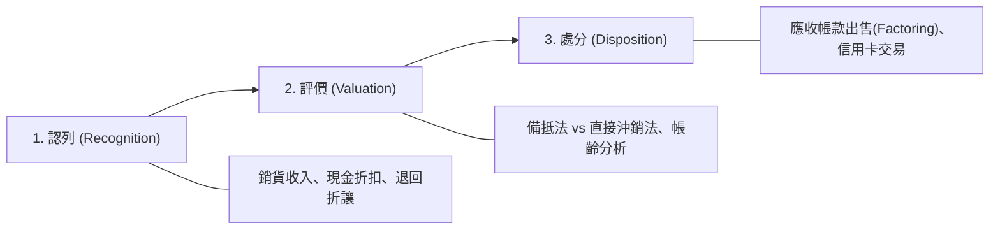

# [Ch 08] 應收帳款與應收票據 (Accounting for Receivables)

> 本頁面為 Chapter 8 的核心骨幹與全覽。涵蓋應收帳款認列、備抵法評價、應收帳款處分與應收票據處理。
> 依據教材：Jerry J. Weygandt, *Financial Accounting (IFRS 5th Edition)*, Chapter 8.

---

## 1. 核心定義與分類 (Receivables Classification & Recognition)

企業的應收款項依商業性質與形式，主要分為三大類：

1. **應收帳款 (Accounts Receivable)**：
   * 企業因在正常營運活動中**賒銷商品或提供勞務**，而對客戶擁有的法定收款權利。通常無須簽訂正式票據，信用期間多為 30 至 60 天。
2. **應收票據 (Notes Receivable)**：
   * 債務人出具之**正式書面承諾 (Formal Promissory Note)**，約定於特定到期日無條件支付確定金額與利息。通常涉及借貸、大額交易或延長信用期間。
3. **其他應收款 (Other Receivables / Non-trade Receivables)**：
   * 非商業營運買賣產生之款項，例如：應收利息 (Interest Receivable)、員工暫借款 (Advances to Employees)、主管借款 (Loans to Officers)、應收退稅 (Income Taxes Refundable) 等。

---

## 2. 應收帳款會計處理架構 (Three Core Accounting Issues)

應收帳款在會計循環中主要涉及三大課題：


### (1) 認列 (Recognition)
* **一般銷貨**：於商品控制權移轉時按交易價格認列。若附帶現金折扣（如 `2/10, n/30`），依規定處理折扣與退折讓。
* **自有信用卡／零售商信用機制**：若客戶逾期未清償，零售商依餘額計收利息，認列為**利息收入 (Interest Revenue)**。

### (2) 評價 (Valuation)
* **評價準則**：流動資產依**淨變現價值 (Net Realizable Value, NRV)** 衡量。
  $$\text{Net Accounts Receivable} = \text{Accounts Receivable (Gross)} - \text{Allowance for Expected Credit Losses}$$
* **IFRS 強制採用「備抵法 (Allowance Method)」**，嚴格禁止「直接沖銷法 (Direct Write-Off Method)」。
* 詳細評價演繹與帳齡分析請參閱：[[Ch08-Valuation-Bad-Debts]]。

### (3) 處分與融資 (Disposition)
* **應收帳款承購/出售 (Factoring)**：將應收帳款折讓售予融資公司（Factor）以快速獲取營運資金，支付 `1% ~ 3%` 之手續費費用 (Service Charge Expense)。
* **第三方信用卡銷售 (Credit Card Sales)**：如 Visa、Mastercard，視同現金交易，但須扣除銀行收取之 `2% ~ 6%` 手續費。

---

## 3. 應收票據之會計處理 (Notes Receivable Mechanics)

應收票據為正式債權證書，具備計息與明確到期日：
* **利息計算公式**：
  $$\text{Interest} = \text{Face Value (面額)} \times \text{Annual Interest Rate (年利率)} \times \text{Time (期間)}$$
  *(通常以一年 360 天計算天數)*
* **到期兌現 (Honor)**：收回面額與應計利息。若跨會計期間，須作期末利息調整分錄。
* **拒付 (Dishonor)**：若預期後續仍可收回，轉列應收帳款；若確認無法收回，則直接由備抵損失沖銷。
* 詳細票據處理與分錄演繹請參閱：[[Ch08-Notes-Receivable]]。

---

## 4. 財務報表表達與勾稽關係 (Financial Statement Linkages)

```text
資產負債表 (Statement of Financial Position)
├── 流動資產 (Current Assets)
│   ├── 應收票據 (Notes Receivable, Net)
│   ├── 應收帳款 (Accounts Receivable)
│   │   └── 減：備抵損失 (Less: Allowance for Doubtful Accounts) -> 淨變現價值
│   └── 應收利息 (Interest Receivable)

損益表 (Income Statement)
├── 營業收入 (Operating Revenue)：銷貨收入 (扣除折扣與退讓)
├── 營業費用 (Operating Expenses)：
│   ├── 預期信用減損損失／壞帳費用 (Bad Debt Expense)
│   └── 手續費費用 (Service Charge Expense)
└── 其他收益與費損 (Other Income & Expenses)：利息收入 (Interest Revenue)

現金流量表 (Statement of Cash Flows - 間接法)
└── 營業活動現金流量 (Operating Cash Flows)
    ├── (+) 預期信用減損損失 (非現金費用加回)
    ├── (-) 應收帳款增加數 (代表本期營收尚未收現)
    └── (+) 應收帳款減少數 (代表前期帳款在本期收現)
```

---

## 5. 企管與管理者視角 (Management Implications & "So What?")

### 1. 商業實質：信用政策的「雙刃劍」效應
* **寬鬆信用政策 (Liberal Credit Policy)**：放寬賒銷門檻與延長授信天數，短期內能刺激營收成長，但會導致營運資金被客戶佔用，並大幅增加違約風險與壞帳成本。
* **緊縮信用政策 (Strict Credit Policy)**：雖然壞帳率降為零，但會驅使優質客戶轉向競爭對手，損害企業市場份額。
* **管理指針**：經理人需透過 [[AR-Turnover-and-DSO]] 監控帳款收現天數，評估信用風險與營收成長的最佳平衡點。

### 2. 營運資金與供應鏈融資策略
* 當企業面臨流動性吃緊時，將應收帳款轉售（Factoring）或票據貼現，是取得即時流動性的工具，但代價是手續費侵蝕營業利潤率。經理人需權衡「手續費成本」與「資金缺口引發之營運斷鏈風險」。

### 3. 盈餘管理與報表操縱防範 (Earnings Management Red Flags)
* **提早認列收入 (Channel Stuffing / Aggressive Recognition)**：在季末對通路商大量塞貨並開立應收帳款以美化營收，次季初再以大量銷貨退回處理。
* **操縱備抵損失比例 (Cookie Jar Accounting / Big Bath)**：
  * 在營運大好時，故意「過度提列」備抵損失（儲存盈餘餅乾罐），以便日後業績不佳時藉由少提減損來粉飾淨利。
  * 審計與經理人應特別檢視帳齡分析的估計百分比是否有無理由的突然變動。

---

## 6. 教學簡報切入點 (Slide Hooks & Visual Ideas)

* **Hook 1 (商業情境引導)**：「客戶簽約買了 1,000 萬，但遲遲不付款，公司到底算不算有賺錢？」引出權責發生制、應收帳款認列與倒閉風險。
* **Hook 2 (左右卡片對比)**：直接沖銷法 vs 備抵法（視覺化呈現為什麼 IFRS 強制規定備抵法才能體現「淨變現價值」）。
* **Hook 3 (互動案例動態拆解)**：Sycamore AG 帳齡分析與沖銷分錄推導（運用 Tab 切換展示調整前、沖銷後、收回後的 T 字帳）。
* **Hook 4 (企業實戰 PK)**：Nike vs Adidas 應收帳款週轉率與收現天數對比（引導學生解讀誰的通盤營運管理更優秀）。

---

## 7. 關聯主題 (Related Pages)

* [[Ch08-Valuation-Bad-Debts]] — 應收帳款評價、備抵法機制與帳齡分析完整題解
* [[Ch08-Notes-Receivable]] — 應收票據計息、跨期調節與拒付會計處理
* [[AR-Turnover-and-DSO]] — 應收帳款週轉率與平均收現期間分析（Nike vs. Adidas 案例）
* [[Ch14-Statement-of-Cash-Flows]] — 現金流量表間接法中應收款項之勾稽調節
