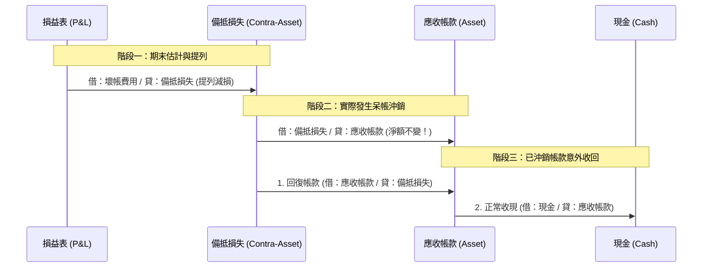

# [Ch 08 專題] 應收帳款評價、備抵法與帳齡分析 (Valuation & Allowance Method)

> 本頁深入剖析應收帳款之核心評價機制、IFRS 規範之備抵法三階段分錄、帳齡分析表推導，以及 Class Exercise 1 的完整演練。

---

## 1. 評價原則與準則要求 (Valuation Principles & IFRS)

應收帳款列報於資產負債表之流動資產項下，其評價標準為**淨變現價值 (Net Realizable Value, NRV / Cash Realizable Value)**，即預期最終能轉化為現金之淨額：

$$\text{Net Accounts Receivable} = \text{Accounts Receivable (總額)} - \text{Allowance for Doubtful Accounts (備抵損失)}$$

### 直接沖銷法 vs 備抵法 (Direct Write-Off vs. Allowance Method)

| 比較維度 | 直接沖銷法 (Direct Write-Off Method) | 備抵法 (Allowance Method) |
| :--- | :--- | :--- |
| **壞帳認列時點** | 實際確定客戶違約、倒閉無法收回時才認列 | 賒銷成立當期期末，依歷史與前瞻經驗**合理估計提列** |
| **配合原則 (Matching)** | ❌ **不符合**（往往銷貨在第一年，壞帳卻認列在第二年） | ✅ **符合**（本期銷貨與其潛在信用損失在同期間認列） |
| **資產淨變現價值** | ❌ **無法反映**（期末資產負債表虛增應收帳款價值） | ✅ **真實反映**（以備抵損失作為評價減項，真實呈現 NRV） |
| **IFRS 準則地位** | ❌ **嚴格禁止**用於編製財務報表 | ✅ **IFRS 9 / IFRS 強制要求採用** |

> [!WARNING] 管理風險警訊
> 直接沖銷法會導致企業在總體經濟轉差、客戶集體違約的年度，利潤突然出現斷崖式暴跌（Dramatic Reduction in Net Income），使經理人無法向董事會與投資人交代，也是典型的盈餘不穩定來源。

---

## 2. 備抵法會計處理三部曲 (Three Stages of Allowance Method)



### 階段一：期末估計與調整 (Estimation & Adjustment)
* 依據期末帳款餘額或帳齡分析推算應有之備抵損失。
```text
借：預期信用減損損失／壞帳費用 (Bad Debt Expense)      $12,000
    貸：備抵損失 (Allowance for Doubtful Accounts)               $12,000
(記錄本期估計之預期信用損失)
```

### 階段二：實際壞帳沖銷 (Write-Off of an Uncollectible Account)
* 當特定客戶確定無法付款時，由主管核准後沖銷。
```text
借：備抵損失 (Allowance for Doubtful Accounts)            $500
    貸：應收帳款 (Accounts Receivable - 特定客戶)                 $500
(沖銷特定客戶帳款)
```

> [!IMPORTANT] 核心觀念：沖銷前後「淨變現價值 (NRV)」絕對不變！
> * **沖銷前**：應收帳款 $200,000 - 備抵損失 $12,000 = **淨變現價值 $188,000**
> * **沖銷後**：應收帳款 $199,500 - 備抵損失 $11,500 = **淨變現價值 $188,000**
> * **管理意涵**：沖銷只是將已經估計好的「整體風險」指派落實到「特定客戶帳戶」，既不影響本期費用，也不影響資產總額。

### 階段三：已沖銷款項意外收回 (Recovery of an Uncollectible Account)
* 若已沖銷之客戶日後重獲資金清償，必須進行兩筆分錄：
```text
(1) 回復該客戶之債權記錄：
借：應收帳款 (Accounts Receivable)                       $500
    貸：備抵損失 (Allowance for Doubtful Accounts)               $500

(2) 記錄正常收款：
借：現金 (Cash)                                         $500
    貸：應收帳款 (Accounts Receivable)                           $500
```

---

## 3. 帳齡分析法與調整金額推導 (Aging of Receivables Schedule)

在實務上，企業採用**應收帳款餘額百分比法 (Percentage-of-Receivables Basis)** 中的**帳齡分析法 (Aging Schedule)** 進行精確估計：
1. 將應收帳款依未到期及逾期天數分組（如未逾期、1-30天、31-60天、61-90天、逾90天）。
2. 逾期天數愈長，給予愈高的預期違約率。
3. **兩步驟推導法 (Two-Step Adjustment Rule)**：
   * **Step 1（決定目標）**：從帳齡分析表加總算出期末**「應有之備抵損失期末貸方餘額 (Target Ending Balance)」**。
   * **Step 2（決定調整分錄金額）**：檢視調整前備抵損失帳戶之餘額（T 字帳）：
     $$\text{調整金額} = \begin{cases} \text{目標貸餘} - \text{調整前貸餘} & (\text{若調整前為貸餘}) \\ \text{目標貸餘} + \text{調整前借餘} & (\text{若調整前為借餘}) \end{cases}$$

---

## 4. 經典課堂題解：Class Exercise 1 (Sycamore AG 完整題解)

### 題目背景
Sycamore AG 2024 年底應收帳款總額為 €285,000，帳齡分佈與預估違約率如下：

| 客戶 | 應收總額 | 未逾期 | 逾期 1–30 天 | 逾期 31–60 天 | 逾期 61–90 天 | 逾期 90 天以上 |
| :--- | :--- | :--- | :--- | :--- | :--- | :--- |
| Anders | €22,000 | | €10,000 | €12,000 | | |
| Blake | €40,000 | €40,000 | | | | |
| Cyr | €57,000 | €16,000 | €6,000 | | €35,000 | |
| Deleon | €34,000 | | | | | €34,000 |
| 其他客戶 | €132,000 | €96,000 | €16,000 | €14,000 | | €6,000 |
| **分組總計** | **€285,000** | **€152,000** | **€32,000** | **€26,000** | **€35,000** | **€40,000** |
| **預估壞帳率** | | **3%** | **6%** | **13%** | **25%** | **50%** |
| **預估壞帳金額** | **€38,610** | €4,560 | €1,920 | €3,380 | €8,750 | €20,000 |

### 問題解答與分錄演繹

#### (a) 完成帳齡分析表
* 應有備抵損失目標餘額 = $152,000 \times 3\% + 32,000 \times 6\% + 26,000 \times 13\% + 35,000 \times 25\% + 40,000 \times 50\% = \mathbf{€38,610}$。

#### (b) 2024 年 12 月 31 日調整分錄
* 已知調整前備抵損失為**貸餘 €12,000**。
* 本期應提列金額 = $€38,610 - €12,000 = \mathbf{€26,610}$。
```text
2024/12/31
借：預期信用減損損失 (Bad Debt Expense)                €26,610
    貸：備抵損失 (Allowance for Doubtful Accounts)               €26,610
```

#### (c) 2025 年度交易分錄
1. **3 月 31 日沖銷 Maria 帳款 €1,000**：
   ```text
   2025/03/31
   借：備抵損失 (Allowance for Doubtful Accounts)       €1,000
       貸：應收帳款 (Accounts Receivable)                         €1,000
   ```
2. **5 月 31 日收到 Maria 清償已被沖銷之帳款 €1,000**：
   ```text
   2025/05/31 (1) 回復帳款：
   借：應收帳款 (Accounts Receivable)                  €1,000
       貸：備抵損失 (Allowance for Doubtful Accounts)              €1,000
   2025/05/31 (2) 收取支票：
   借：現金 (Cash)                                    €1,000
       貸：應收帳款 (Accounts Receivable)                         €1,000
   ```
3. **7 月 31 日財務長核准沖銷 Roger 帳款 €9,000**：
   ```text
   2025/07/31
   借：備抵損失 (Allowance for Doubtful Accounts)       €9,000
       貸：應收帳款 (Accounts Receivable)                         €9,000
   ```

#### (d) 2025 年 12 月 31 日期末調整分錄
* 假設 2025 年底帳齡分析計算出應有備抵餘額為 **€41,000**。
* **T 字帳推導過程**：
  $$\text{調整前餘額} = 38,610 \text{ (初)} - 1,000 \text{ (沖銷)} + 1,000 \text{ (收回)} - 9,000 \text{ (沖銷)} = \mathbf{€29,610 \text{ (貸餘)}}$$
  $$\text{本期調整提列數 (x)} = 41,000 - 29,610 = \mathbf{€11,390}$$
```text
2025/12/31
借：預期信用減損損失 (Bad Debt Expense)                €11,390
    貸：備抵損失 (Allowance for Doubtful Accounts)               €11,390
```

---

## 5. 應收帳款處分與融資 (Disposing of Accounts Receivable)

當企業需要立即周轉資金或不願耗費大量催收管理成本時，有兩種主要處分管道：

### 1. 應收帳款出售／承購 (Sale of Receivables to a Factor)
* 融資機構（Factor）收購企業之應收帳款，直接向客戶收款，並收取 1% ~ 3% 佣金手續費。
* **範例 (Keelung Jewelry)**：出售 NT$600,000 應收帳款，手續費率 2%（即 NT$12,000）：
```text
借：現金 (Cash)                                      $588,000
借：手續費費用 (Service Charge Expense)                 $12,000
    貸：應收帳款 (Accounts Receivable)                           $600,000
```

### 2. 接受第三方信用卡銷售 (Credit Card Sales)
* 如 Visa、MasterCard，屬於即時無追索權之現金銷貨，但發卡銀行收取 2% ~ 6% 手續費。
* **範例 (Yang Music Co.)**：銷售 NT$6,000，Visa 銀行收取 3% 手續費（即 NT$180）：
```text
借：現金 (Cash)                                        $5,820
借：手續費費用 (Service Charge Expense)                   $180
    貸：銷貨收入 (Sales Revenue)                                  $6,000
```

---

## 6. 企管決策與財務警訊 (Management Implications)

1. **帳齡分析矩陣的「風險早警信號」**：
   * 當逾期 61 天以上帳款佔比顯著上升時，代表下游客戶的現金流正在惡化，管理層應即刻啟動**授信額度凍結 (Credit Freezing)**。
2. **盈餘管理的「大洗澡 (Big Bath)」與「餅乾罐 (Cookie Jar)」**：
   * 新任 CEO 上任時，常透過調高帳齡預估違約率（例如將逾期 90 天違約率從 50% 提高至 80%），一次性認列鉅額壞帳費用，將責任歸咎於前任；隔年再藉由回轉或低提減損創造高獲利。
3. **營運資金 (Working Capital) 代價**：
   * 承購手續費 2% 看似不高，但若該帳款平均 30 天收現，其**隱含年化資金成本率 (APR)** 高達：
     $$\text{Annualized Rate} \approx 2\% \times \frac{360}{30} = \mathbf{24\%}$$
   * 經理人應意識到應收帳款融資屬於高成本緊急融資手段。

---

## 7. 關聯主題 (Related Concepts)

* [[Ch08-Receivables]] — Chapter 8 全章核心導航
* [[AR-Turnover-and-DSO]] — 應收帳款週轉率與帳款回收天數評估
* [[Ch14-Statement-of-Cash-Flows]] — 壞帳費用在營業活動現金流中的加回機制
