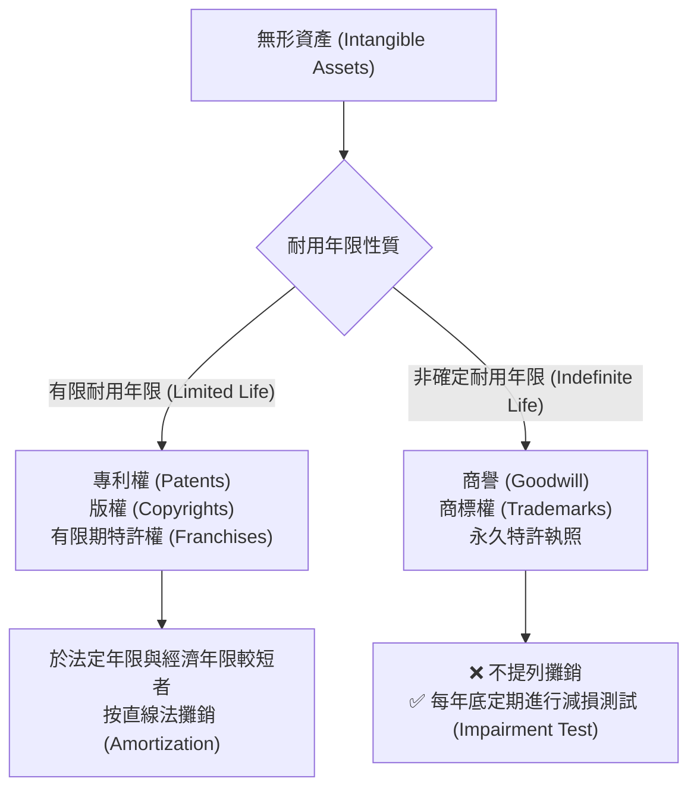
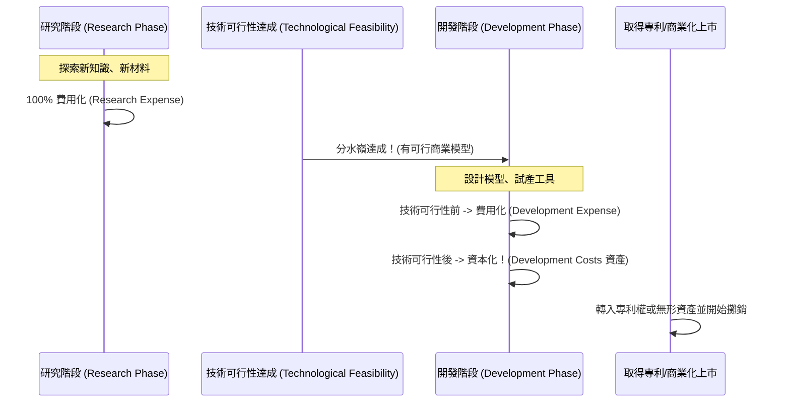

# [Ch 09 專題] 天然資源折耗、無形資產攤銷與研發支出 (Natural Resources & Intangibles)

> 本頁深入剖析天然資源之折耗（計入存貨）、無形資產分類與攤銷規範、IFRS 研發支出（技術可行性之資本化分水嶺），以及 Class Exercise 2 (Glover Restaurants) 的完整演練。

---

## 1. 天然資源與折耗 (Natural Resources & Depletion)

天然資源（如石油、天然氣、礦產、林木）具有兩大特徵：(1) 隨開採而實體消耗；(2) 除非透過自然界漫長地質作用，否則無法由人力重置。

### 折耗之計量與會計處理
天然資源採用**生產數量法 (Units-of-Activity Method)** 計算折耗：
$$\text{Depletion Cost per Unit (每單位折耗成本)} = \frac{\text{取得總成本} - \text{殘值}}{\text{總估計可採蘊藏量}}$$

> [!IMPORTANT] 核心觀念陷阱：開採時折耗「不是費用」，而是「存貨」！
> 採礦企業開採出礦產時，並未產生直接損益，而是將「地下的天然資源資產」轉化為「地上的存貨資產」：
> * **開採時分錄**：
>   ```text
>   借：存貨 (Inventory - 煤礦存貨)                       $1,250,000
>       貸：累計折耗 (Accumulated Depletion)                       $1,250,000
>   ```
> * **實際售出時分錄**：
>   ```text
>   借：銷貨成本 (Cost of Goods Sold)                     $1,250,000
>       貸：存貨 (Inventory - 煤礦存貨)                           $1,250,000
>   ```

---

## 2. 無形資產之分類與會計處理 (Intangible Assets)

無形資產係指企業擁有或控制之**無實體形式、具可辨認性之長期非貨幣性資產**。依其耐用年限是否可合理估計，分為兩大類：



### 常見無形資產與會計準則

1. **專利權 (Patents)**：法律保護年限多為 20 年。外購專利資本化，按法定壽命與經濟壽命取**較短者**攤銷。
2. **版權 (Copyrights)**：文字、藝術創作享有，通常為作者終身加數十年，於預期受益期間內攤銷。
3. **商標權 (Trademarks & Trade Names)**：多可無限次續展，故視為非確定耐用年限，**不攤銷**，僅作減損測試。
4. **特許權與授權 (Franchises & Licenses)**：依合約期間攤銷；若為永久性則不攤銷。
5. **商譽 (Goodwill)**：**僅限於企業併購 (Business Combination) 時產生**（收購代價超過被收購企業可辨認淨資產公允價值之差額）。企業內部自行創造之商譽**嚴禁資本化**。商譽**不攤銷**，每年必須進行強制減損測試。

---

## 3. 研究發展支出 (R&D Costs) 之會計處理

R&D 支出往往伴隨極高失敗風險，IFRS 嚴格規定兩階段分水嶺：



* **廣告與行銷費用 (Advertising Expenses)**：即便聘請頂級球星代言能帶來長期品牌效益，會計準則一律規定於**播出當期全數列為營業費用**，絕對不得資本化為無形資產。

---

## 4. 經典課堂題解：Class Exercise 2 (Glover Restaurants 完整詳解)

### 2024 年底期初狀態
* **Patents (專利權)**：成本 £60,000，累計攤銷 £6,000，淨額 **£54,000**（2024/1 取得，年限 10 年）。
* **Franchises (特許權)**：成本 £48,000，累計攤銷 £19,200，淨額 **£28,800**（2021/1 取得，年限 10 年）。

### 2025 年度交易分錄演繹

#### 1 月 1 日：購入新專利權 £45,000（年限 9 年）
```text
借：專利權 (Patents)                                  £45,000
    貸：現金 (Cash)                                             £45,000
```

#### 1 月 ~ 6 月：新產品研發支出 £168,000（研究 £100,000 + 技術可行性前之開發 £68,000）
* 準則判定：技術可行性達成前之研究與開發費用，**必須全數費用化**！
```text
借：研發費用 (Research and Development Expense)       £168,000
    貸：現金 (Cash)                                             £168,000
```

#### 9 月 1 日：支付 £58,000 聘請美式足球巨星拍攝形象廣告
* 準則判定：廣告宣傳代言支出，**屬於營業費用，不得資本化**！
```text
借：廣告費用 (Advertising Expense)                     £58,000
    貸：現金 (Cash)                                             £58,000
```

#### 10 月 1 日：以 £100,000 取得新特許權（年限 40 年）
```text
借：特許權 (Franchises)                              £100,000
    貸：現金 (Cash)                                             £100,000
```

---

### 2025 年底期末攤銷調整分錄 (12/31)

1. **專利權攤銷 (Patents Amortization)**：
   * 舊專利權：$£60,000 \times 1/10 = £6,000$
   * 新專利權：$£45,000 \times 1/9 = £5,000$
   * **年度專利攤銷費用合計** $= 6,000 + 5,000 = \mathbf{£11,000}$
   ```text
   借：攤銷費用 (Amortization Expense)                  £11,000
       貸：專利權 (Patents) 或 累計攤銷                           £11,000
   ```

2. **特許權攤銷 (Franchises Amortization)**：
   * 舊特許權：$£48,000 \times 1/10 = £4,800$
   * 10/1 新特許權（提列 3 個月）：$£100,000 \times \frac{1}{40} \times \frac{3}{12} = £625$
   * **年度特許權攤銷費用合計** $= 4,800 + 625 = \mathbf{£5,425}$
   ```text
   借：攤銷費用 (Amortization Expense)                   £5,425
       貸：特許權 (Franchises) 或 累計攤銷                          £5,425
   ```

---

### 2025 年 12 月 31 日資產負債表表達 (Statement of Financial Position)

```text
無形資產 (Intangible Assets)：
  專利權 (Patents) (註 1)                             £88,000
  特許權 (Franchises) (註 2)                          £123,375
無形資產合計 (Total Intangible Assets)                 £211,375

註釋說明：
註 1：專利權成本 (£60,000 + £45,000) 扣除累計攤銷 (£6,000 + £11,000) = £88,000
註 2：特許權成本 (£48,000 + £100,000) 扣除累計攤銷 (£19,200 + £5,425) = £123,375
```

---

## 5. 企管決策與財務警訊 (Management Implications)

1. **研發支出與盈餘品質 (R&D Aggressiveness)**：
   * 經理人可能故意放寬內部「技術可行性 (Technological Feasibility)」的認定期點，將大量研發人事費用過早資本化為無形資產，以此美化當期淨利。投資人應檢視資本化研發專案的後續專利通過率與商用營收轉換率。
2. **商譽減損的「大洗澡 (Big Bath)」風險**：
   * 跨國企業在進行溢價併購時會產生龐大商譽（Goodwill）。由於商譽不逐年攤銷，若併購效益未如預期，經理人往往隱匿拖延，直到景氣低迷或更換執行長時才一次性提列數十億的商譽減損（巨額虧損一次洗掉），這是經理人調節利潤的經典重災區。

---

## 6. 關聯主題 (Related Concepts)

* [[Ch09-Plant-Assets]] — Chapter 9 核心導航
* [[Ch09-Depreciation-and-Disposal]] — 折舊方法、重估價與處分
* [[Asset-Turnover]] — 資產週轉率分析
* [[CapEx-Depreciation-and-Cash-Flow]] — 資本支出與現金流量表勾稽
