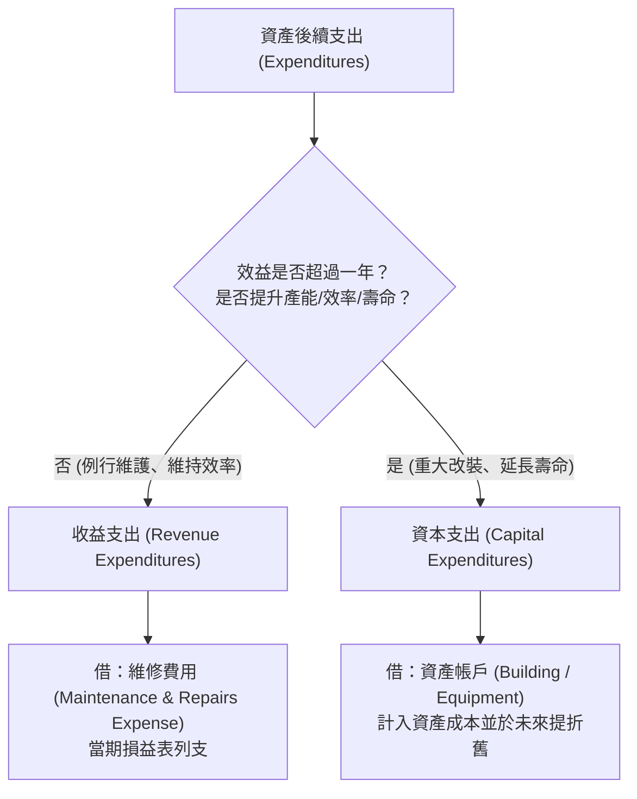

# [Ch 09] 不動產、廠房及設備、天然資源與無形資產 (Plant Assets, Natural Resources, and Intangible Assets)

> 本頁面為 Chapter 9 的核心骨幹與全覽。涵蓋不動產廠房及設備（PPE）成本認定、資本支出 vs 收益支出、折舊與處分、天然資源折耗、無形資產攤銷與研發費用處理。
> 依據教材：Jerry J. Weygandt, *Financial Accounting (IFRS 5th Edition)*, Chapter 9.

---

## 1. 不動產、廠房及設備之定義與分類 (Plant Assets / PPE Characteristics)

不動產、廠房及設備（Property, Plant, and Equipment, PPE）具備四項核心特徵：
1. **具有實體形式 (Physical Substance)**：有具體長寬高、實體形貌。
2. **供營業活動使用 (Used in Operations)**：非供投資買賣或閒置。
3. **非以出售為目的 (Not Intended for Sale to Customers)**：區別於存貨（Inventory）。
4. **預期提供多年經濟效益 (Expected to Provide Service for Multiple Years)**：具長期性，屬於非流動資產。

---

## 2. 歷史成本認定原則 (Historical Cost Principle)

成本包含**「為取得該資產並使其達到可供使用狀態與地點之一切必要且合理的合理支出」**：

| 資產類別 | 包含之必要成本 (Capitalized Costs) | 排除之費用（不得資本化） | 折舊與否 |
| :--- | :--- | :--- | :--- |
| **土地 (Land)** | 購買價款、產權過戶費、律師費、經紀人佣金、整地與拆除舊建物淨成本（拆除成本扣除殘料變賣收入）、承擔之欠稅 | 鋪設柏油路、圍籬、路燈（此為土地改良） | ❌ **不提折舊**（壽命無限、地力通常不損） |
| **土地改良 (Land Improvements)** | 停車場鋪設、車道、圍籬、戶外照明、地下噴灌系統 | 日常清掃、重新粉刷標線（收益支出） | ✅ **須提折舊**（壽命有限） |
| **建築物 (Buildings)** | 購買價款、產權保險費、佣金；**自建時**包含建築師費、建照許可費、開挖工程費、**建造期間之借款利息資本化** | 完工後之火災保險、維修費 | ✅ **須提折舊** |
| **設備 (Equipment)** | 現金購買價、營業稅/關稅、運費、運送途中保險、組裝安裝費、測試運轉費 | 每年牌照稅/行照規費（當期費用）、車輛車禍意外保險（預付保險） | ✅ **須提折舊** |

---

## 3. 耐用年限期間之後續支出 (Expenditures during Useful Life)

企業在資產使用年限內發生的支出，必須嚴格區分為兩大類：



> [!IMPORTANT] 重大性原則 (Materiality Concept)
> 若支出金額極小（例如買一把 $100 的扳手），即便能使用數年，依重大性原則仍可直接列為當期費用，無須資本化。

---

## 4. 全章三大核心支柱頁面導航

本章深入內容已拆解為以下專題頁面：

1. [[Ch09-Depreciation-and-Disposal]]：
   * 三大折舊方法（直線法、生產數量法、倍數餘額遞減法）全期折舊表與期中購買破月計算。
   * IFRS 組成份子折舊（Component Depreciation）、重估價模式（Revaluation）、折舊估計變動。
   * 資產報廢（Retirement）與出售（Sale）、**Class Exercise 1 (Jimenez Enterprises) 完整題解與 T 字帳**。
2. [[Ch09-Natural-Resources-and-Intangibles]]：
   * 天然資源與折耗（Depletion）：產出計入存貨、銷售轉銷貨成本。
   * 無形資產（專利權、版權、商標、特許權、商譽）之認列、有限生命攤銷 vs 無限生命減損測試。
   * **研究與發展支出 (R&D Costs)**：研究階段 100% 費用化；開發階段達技術可行性後資本化。
   * **Class Exercise 2 (Glover Restaurants) 完整題解**。
3. [[Asset-Turnover]]：
   * 財務比率庫：資產週轉率公式、企業重資產 vs 輕資產營運效率分析。

---

## 5. 財務報表表達與勾稽關係 (Financial Statement Linkages)

```text
資產負債表 (Statement of Financial Position)
├── 非流動資產 (Non-Current Assets)
│   ├── 不動產、廠房及設備 (Property, Plant, and Equipment)
│   │   ├── 土地 (Land, 不折舊)
│   │   ├── 土地改良 (Land Improvements - 減：累計折舊)
│   │   ├── 建築物 (Buildings - 減：累計折舊)
│   │   └── 設備 (Equipment - 減：累計折舊)
│   ├── 天然資源 (Natural Resources - 減：累計折耗)
│   └── 無形資產 (Intangible Assets - 減：累計攤銷)

損益表 (Income Statement)
├── 營業費用 (Operating Expenses)：折舊費用、攤銷費用、維修費用、研究發展費用
├── 其他收益與費損 (Other Income & Expenses)：處分資產利益／損失、資產減損損失
└── 其他綜合損益 (OCI)：重估增值 (Revaluation Surplus)

現金流量表 (Statement of Cash Flows)
├── 營業活動 (Operating Activities)：(+) 折舊與攤銷費用 (非現金項目加回)
└── 投資活動 (Investing Activities)：
    ├── (-) 資本支出 (Purchase of PPE / CapEx)
    └── (+) 處分固定資產收回價款 (Proceeds from Sale of Plant Assets)
```

---

## 6. 企管與管理者視角 (Management Implications)

1. **折舊政策對稅盾與 EBITDA 的策略影響**：
   * 採用**加速折舊法（倍數餘額遞減法）**在資產初期認列高額折舊，能產生「節稅盾牌（Tax Shield）」，延後所得稅現金流出，為企業保留更多初期營運周轉金。
   * 折舊為非現金費用，在計算 **EBITDA（稅前息前折舊攤銷前獲利）** 時會被加回。經理人需注意，部分企業可能藉由重資產資本支出拉高 EBITDA，但自由現金流其實持續失血。
2. **資本化 vs 費用化的盈餘操縱風險 (Capitalization vs. Expensing Fraud)**：
   * 經理人為達成短期獲利目標，最常見的舞弊手段是**「將平時維護費用違規資本化為固定資產」**（如世通 WorldCom 案例，將上百億線路成本資本化），以此虛增當期淨利。
   * 審計與投資人應特別比對資本支出（CapEx）年增率與折舊年限的合理性。

---

## 7. 關聯主題 (Related Pages)

* [[Ch09-Depreciation-and-Disposal]] — 折舊三大方法、組成份子折舊與資產處分完整題解
* [[Ch09-Natural-Resources-and-Intangibles]] — 天然資源折耗、無形資產攤銷與 R&D 資本化
* [[Asset-Turnover]] — 資產週轉率與企管營運效率分析
* [[CapEx-Depreciation-and-Cash-Flow]] — 資本支出、折舊與自由現金流 (FCF) 勾稽專題
* [[Ch14-Statement-of-Cash-Flows]] — 現金流量表投資活動與非現金調節
