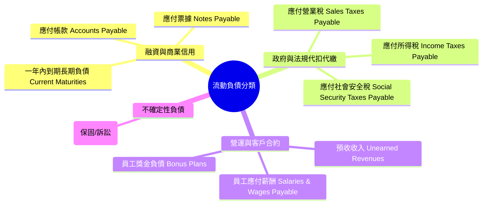

# [Ch 10] 流動負債與負債準備 (Current Liabilities & Provisions)

> 本頁面為 Chapter 10 的核心骨幹與全覽。涵蓋流動負債定義、各類確定流動負債（應付票據、營業稅、預收收入、員工薪酬負債、一年內到期之長期負債）與報表結構。
> 依據教材：Jerry J. Weygandt, *Financial Accounting (IFRS 5th Edition)*, Chapter 10.

---

## 1. 核心定義與分類 (Current Liabilities Definition & Classification)

**流動負債 (Current Liabilities)** 係指企業預期符合下列條件之一的債務義務：
1. 預期於**一年或一個正常營業週期 (Operating Cycle)** 內清償（以較長者為準）。
2. 主要係為交易目的而持有。
3. 通常必須以企業既有的**流動資產 (Current Assets)** 清償，或透過產生另一項流動負債來替代。

---

## 2. 常見確定流動負債與會計處理 (Common Current Liabilities)



### (1) 應付票據 (Notes Payable)
* 以書面本票承諾付款，多數附帶利息。
* **跨期利息處理（範例：Yang Enterprises）**：
  * 9 月 1 日向銀行簽發 4 個月期、年息 12% 面額 $100,000 本票，次年 1 月 1 日到期。
  * 12 月 31 日期末應計 4 個月利息：$\$100,000 \times 12\% \times \frac{4}{12} = \$4,000$。
  ```text
  12/31 借：利息費用 (Interest Expense)                 $4,000
            貸：應付利息 (Interest Payable)                       $4,000
  01/01 借：應付票據 (Notes Payable)                  $100,000
        借：應付利息 (Interest Payable)                   $4,000
            貸：現金 (Cash)                                      $104,000
  ```

### (2) 應付營業稅 (Sales Taxes Payable)
* 營業稅係政府向最終消費者課徵之消費稅，零售商僅扮演**「代收代繳之受託人（Collection Agent）」**，因此營業稅**絕對不是賣方的營業費用**！
* **Case 1（稅外加）**：銷貨 $800，營業稅率 6%（稅額 $48）：
  ```text
  借：現金 (Cash)                                      $848
      貸：銷貨收入 (Sales Revenue)                                  $800
      貸：應付營業稅 (Sales Taxes Payable)                            $48
  ```
* **Case 2（稅內含）**：收銀機總現金流入 $10,600（內含 6% 營業稅）：
  $$\text{實際銷貨收入} = \frac{\$10,600}{1 + 6\%} = \$10,000, \quad \text{應付營業稅} = \$10,600 - \$10,000 = \$600$$

### (3) 預收收入 (Unearned Revenues)
* 商品或勞務尚未交付前預先向客戶收取的款項（如預售足球賽門票、機票、訂閱軟體 SaaS 預收款）。
* **收到預收款時**列為流動負債；**履行合約義務時**轉列為營業收入。

### (4) 薪酬相關負債 (Payroll and Payroll Deductions)
雇主發放員工薪資時，需區分「員工負擔（代扣）」與「雇主自身負擔（額外費用）」：
* **員工負擔代扣款 (Payroll Deductions)**：
  * 員工薪資總額（如 $10,000）扣除：代扣所得稅 ($1,320)、員工負擔社會安全稅 ($800)、工會會費 ($88) $\implies$ 員工實領淨薪資（應付薪資 $7,792）。
* **雇主負擔薪資稅 (Employer's Payroll Taxes)**：
  * 雇主法定必須為員工提撥之社會安全稅（如 $800），直接列為企業當期之**「薪資稅費用 (Payroll Tax Expense)」**。

### (5) 一年內到期之長期負債 (Current Maturities of Long-Term Debt)
* 長期借款或公司債中，將於未來 12 個月內到期償還的本金部分。
* **會計處理**：**期末不需作調整分錄**！在編製資產負債表日時，直接自非流動負債中重分類至流動負債項下列示。

---

## 3. 全章專題頁面導航

1. [[Ch10-Provisions-and-Contingencies]]：
   * IAS 37 負債準備（Provisions）三大法定認列要件。
   * 產品保固（Product Warranties）完整會計處理流程與推導。
   * 或有負債（Contingent Liabilities）與或有資產（Contingent Assets）處理矩陣。
   * **Class Exercise 1 (Ting Manufacturing, E10.9) 完整詳解**。
2. [[Liquidity-and-Working-Capital]]：
   * 營運資金（Working Capital）、流動比率（Current Ratio）、速動比率（Acid-Test Ratio）。
   * **Class Exercise 2 (Chen Group, P10.6) 完整詳解**。
   * 企管視角：流動性 vs. 獲利性權衡、破解期末「美化報表 (Window Dressing)」手法。
3. [[Working-Capital-and-Cash-Flow]]：
   * 跨章節綜合分析：流動負債變動在現金流量表（間接法）中的加減項勾稽。

---

## 4. 財務報表表達架構 (Financial Statement Presentation)

```text
資產負債表 (Statement of Financial Position - 負債部分)
├── 流動負債 (Current Liabilities)
│   ├── 應付票據 (Notes Payable)
│   ├── 應付帳款 (Accounts Payable)
│   ├── 應付營業稅／代扣稅捐 (Sales & Taxes Payable)
│   ├── 預收收入 (Unearned Revenues)
│   ├── 應付薪資與獎金 (Salaries and Wages Payable)
│   ├── 負債準備－產品保固 (Provision for Warranties)
│   └── 一年內到期之長期借款 (Current Maturity of Long-Term Debt)
└── 非流動負債 (Non-Current Liabilities)
    ├── 應付公司債 (Bonds Payable)
    └── 長期抵押借款 (Mortgage Payable)
```

---

## 5. 企管與管理者視角 (Management Implications)

1. **商業信用（應付帳款）是企業成本最低的無息融資**：
   * 企業延後支付供應商款項（拉長 DPO），實質上是在無息佔用供應鏈上下游的營運資金。但過度拖延會損害商業信譽與評級，導致供應商調高報價。
2. **預收收入（Deferred/Unearned Revenue）是最高質量的商業模式**：
   * 如微軟 Office 365 訂閱、星巴克儲值卡、好市多會員年費。企業在尚未提供服務前就已將現金落袋，創造極佳的營運現金流。
3. **流動負債過期暴雷風險**：
   * 「以短支長」（用短期票據或借款來購置長期廠房設備）是企業流動性危機的最主要原因。一旦銀行抽銀根或不予展期，將直接引發週轉不靈倒閉。

---

## 6. 關聯主題 (Related Pages)

* [[Ch10-Provisions-and-Contingencies]] — 負債準備與或有負債深入剖析
* [[Liquidity-and-Working-Capital]] — 營運資金與流動比率分析
* [[Working-Capital-and-Cash-Flow]] — 營運資金與現金流量表間接法勾稽專題
* [[Ch11-Non-Current-Liabilities]] — 接續章節：非流動負債與公司債
