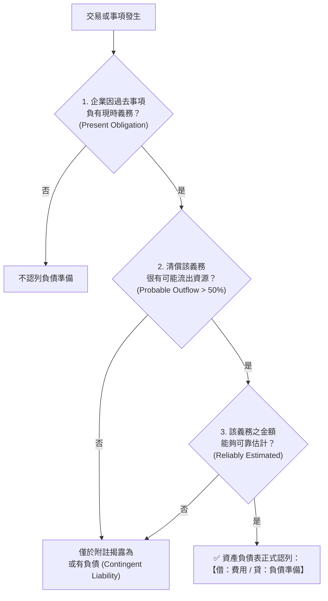

# [Ch 10 專題] 負債準備、產品保固與或有負債 (Provisions & Contingencies)

> 本頁深入剖析 IFRS (IAS 37) 之負債準備三大法定認列要件、產品保固（Warranty）之跨期推導與會計分錄、或有事項決策矩陣，以及 Class Exercise 1 (Ting Manufacturing) 的完整詳解。

---

## 1. 負債準備之核心定義 (Definition of Provision)

依據 **IAS 37（負債準備、或有負債及或有資產）**，**負債準備 (Provision)** 係指**「時間或金額具不確定性之負債」**。

### 負債準備與一般負債之區別
* **一般確定負債 (Accounts/Notes Payable)**：到期日與金額皆確定（例如本票面額 $10,000，10 月 1 日到期）。
* **應計負債 (Accrued Liabilities)**：金額與時間雖需估計，但通常基於確定帳單或合約（例如應付水電費、應付利息）。
* **負債準備 (Provisions)**：**金額或清償時點具有高度估計不確定性**，但因符合特定要件，必須於資產負債表內正式認列為負債（如產品保固準備、訴訟賠償準備、環境復原準備）。

---

## 2. 負債準備之三大法定認列要件 (IAS 37 Recognition Criteria)

企業只有在**同時符合**下列三項條件時，才得以在財務報表中認列負債準備：



---

## 3. 或有事項之會計處理決策矩陣 (Contingencies Matrix)

| 發生機率等級 (Probability) | 定義範圍 | 或有負債 (Contingent Liability) 處理 | 或有資產 (Contingent Asset) 處理 |
| :--- | :--- | :--- | :--- |
| **很有可能 (Probable)** | 機率大於 50% | 若金額可估計 $\to$ **認列負債準備**<br>若金額無法可靠估計 $\to$ **附註揭露** | **附註揭露**（嚴禁列入資產負債表） |
| **有可能 (Possible)** | 機率介於 5% ~ 50% | **附註揭露 (Disclose in Notes)** | **不作任何處理**（不認列、不揭露） |
| **極少可能 (Remote)** | 機率小於 5% | **不作任何處理 (Do Nothing)** | **不作任何處理 (Do Nothing)** |

> [!CAUTION] 會計穩健原則之體現
> 會計對「潛在義務（負債）」採取較嚴格標準（只要很有可能且可估計就入帳，可能則揭露）；但對「潛在利益（資產）」極度保守（即便很有可能也不准入帳，只能附註說明），防範虛增資產。

---

## 4. 產品保固之會計處理模型 (Product Warranty Accounting)

依據**配合原則 (Matching Principle)**，保固服務係伴隨商品銷售而產生之義務，因此**預估之保固費用必須在銷貨成立的同一會計期間全額認列**。

### 兩階段核算公式：
1. **全期估計總瑕疵數**：
   $$\text{Total Estimated Defective Units} = \text{Total Units Sold (總銷售量)} \times \text{Defective Rate (預估瑕疵率)}$$
2. **年底流通在外未修復瑕疵數 (Units Outstanding)**：
   $$\text{Units Outstanding} = \text{Total Estimated Defective Units} - \text{In-Year Repaired Units (當年已維修數)}$$
3. **期末應提列之產品保固負債準備**：
   $$\text{Estimated Warranty Liability} = \text{Units Outstanding} \times \text{Average Repair Cost per Unit (每單位平均維修費)}$$

---

## 5. 課堂實戰詳解：Class Exercise 1 (Ting Manufacturing, E10.9)

### 題目背景
廷製造公司 (Ting Manufacturing) 銷售產品附帶 75 天保固期。歷史經驗顯示，約有 **3%** 的產品會在保固期內發生瑕疵，每單位平均維修成本為 **NT$15**（千元）。
2025 年最後兩個月營運數據如下：
* **11 月**：銷售 30,000 單位，12 月 31 日前實際發生並修復 600 單位瑕疵。
* **12 月**：銷售 32,000 單位，12 月 31 日前實際發生並修復 400 單位瑕疵。

---

### 問題解答與分錄演繹

#### (a) 記錄 2025 年內履行 1,000 件保固合約之實際維修支出
* 11~12 月累計實際修復件數 $= 600 + 400 = 1,000$ 單位。
* 實際支出金額 $= 1,000 \times \text{NT}\$15 = \mathbf{\text{NT}\$15,000}$（千元）。
```text
2025 年 11~12 月
借：產品保固費用 (Warranty Expense)                  NT$15,000
    貸：零件存貨／現金 (Repair Parts / Cash)                    NT$15,000
(記錄履行 2025 年銷貨之 1,000 件保固維修支出)
```

#### (b) 計算 12 月 31 日資產負債表應列報之產品保固負債準備
* 總銷售量 $= 30,000 + 32,000 = 62,000$ 單位。
* 預期全期瑕疵總數 $= 62,000 \times 3\% = \mathbf{1,860 \text{ 單位}}$。
* 截至 12 月 31 日已修復 $= 1,000$ 單位。
* **年底尚未發生或尚未送修之潛在瑕疵單位 (Units Outstanding)** $= 1,860 - 1,000 = \mathbf{860 \text{ 單位}}$。
* **應計負債準備金額** $= 860 \times \text{NT}\$15 = \mathbf{\text{NT}\$12,900}$（千元）。

```text
2025 年 12 月 31 日 (期末調整分錄)
借：產品保固費用 (Warranty Expense)                  NT$12,900
    貸：負債準備－產品保固 (Warranty Liability / Provision)     NT$12,900
(提列 2025 年銷貨尚未兌現之估計保固負債準備)
```

> [!NOTE] 驗證本期總費用
> 2025 年度認列之總保固費用 $= 15,000 + 12,900 = \mathbf{\text{NT}\$27,900}$。
> 恰好等於全期預估總瑕疵成本：$1,860 \text{ 單位} \times \text{NT}\$15 = \mathbf{\text{NT}\$27,900}$。完全符合配合原則！

#### (c) 記錄 2026 年 1 月履行 500 件保固合約之分錄
* 2026 年 1 月客戶送修 500 單位，維修成本 $= 500 \times \text{NT}\$15 = \mathbf{\text{NT}\$7,500}$（千元）。
* 因該筆銷貨之費用已於 2025 年全額認列，此時**直接沖轉負債準備**，不再認列費用：
```text
2026 年 1 月 31 日
借：負債準備－產品保固 (Warranty Liability)           NT$7,500
    貸：零件存貨／現金 (Repair Parts / Cash)                     NT$7,500
(沖轉已提列之保固負債準備)
```

---

## 6. 企管管理者視角 (Management Implications)

1. **品質良率與毛利率的即時警訊**：
   * 保固負債準備率（3%）直接反映製造良率與供應商品質。若品管出包（例如三星 Note 7 電池自燃危機），保固準備金與維修費用會呈指數級暴增，重創當期獲利與品牌商譽。
2. **盈餘管理的「餅乾罐 (Cookie Jar)」操縱手段**：
   * 由於瑕疵率（3%）與單位維修費（$15）均由管理層主觀估計，經理人常藉由**在豐年多提準備（藏利潤）、在荒年少提或回轉（補獲利）**來平滑損益。
   * 審計師與投資分析師應密切追蹤歷年「實際維修支出」與「預提準備」之差額趨勢。

---

## 7. 關聯主題 (Related Concepts)

* [[Ch10-Current-Liabilities]] — Chapter 10 核心導航
* [[Liquidity-and-Working-Capital]] — 營運資金與短期流動性指標
* [[Working-Capital-and-Cash-Flow]] — 負債準備與營業活動現金流勾稽
