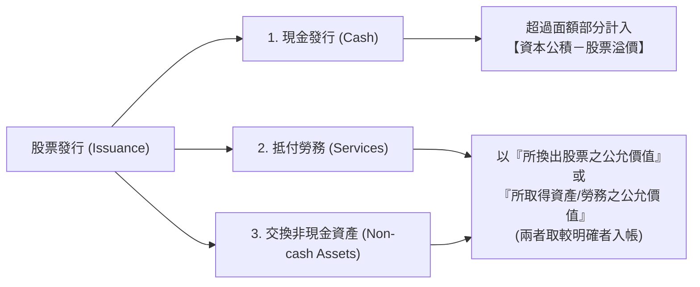

# [Ch 12] 公司組織、股本交易與權益 (Corporations: Organization, Shares & Equity)

> 本頁面為 Chapter 12 的核心骨幹與全覽。涵蓋公司組織特徵、股份種類（普通股 vs. 特別股）、股份發行（現金、勞務、非現金資產）、庫藏股會計處理（成本法）與股東權益結構。
> 依據教材：Jerry J. Weygandt, *Financial Accounting (IFRS 5th Edition)*, Chapter 12.

---

## 1. 公司組織形式與股東權利 (Corporate Characteristics & Rights)

**公司 (Corporation)** 係依法律成立、與其所有權人（股東）**完全分離且獨立的法定法人人格 (Separate Legal Entity)**。

### 公司特徵優缺點對比
* **優點 (Advantages)**：
  1. **獨立法人人格**：得以自身名義擁有財產、簽訂合約、起訴或應訴。
  2. **股東有限責任 (Limited Liability)**：股東之最大損失僅限於其出資認股金額。
  3. **股權易於轉讓 (Transferable Ownership)**：公開市場買賣股票，不影響公司營運。
  4. **資本籌集能力強 (Capital Accumulation)**：向大眾發行股票或公司債。
  5. **永續經營 (Continuous Life)**：所有權人更迭或死亡不影響公司存續。
  6. **管理權與所有權分離**：委由專業經理人營運。
* **缺點 (Disadvantages)**：
  1. **雙重課稅 (Double Taxation)**：公司繳納營利事業所得稅，股東分得股利再繳個人綜所稅。
  2. **嚴格政府管制 (Government Regulation)**：受證券法規監管，需定期公開財務報告。

### 股東四大法定權利 (Shareholder Rights)
1. **表決權 (Voting Right)**：選舉董事會成員及重大議案表決。
2. **盈餘分配權 (Dividend Right)**：按持股比例分派公司盈餘（現金或股票股利）。
3. **現有股東優先認購權 (Preemptive Right)**：公司發行新股時，現有股東有權依原持股比例優先認購，以防股權比例與表決權遭稀釋。
4. **剩餘財產分配權 (Residual Claim)**：公司清算解散時，於清償所有債權人後，按持股比例分配剩餘財產。

> [!NOTE] 開辦費 (Organization Costs)
> 設立公司所發生的法律、政府規費及推廣費用，會計上一律於**發生當期全數列為營業費用**，不得資本化。

---

## 2. 股份發行之會計處理 (Issuance of Shares)



### (1) 現金發行 (Issuance for Cash)
* 範例：發行面額 €1 之普通股 1,000 股，每股發行價 €5：
  ```text
  借：現金 (Cash, 1,000 × €5)                           €5,000
      貸：股本－普通股 (Share Capital - Ordinary, 1,000 × €1)        €1,000
      貸：資本公積－股票溢價 (Share Premium - Ordinary)             €4,000
  ```

### (2) 以股份交換勞務或非現金資產 (Non-Cash Considerations)
* **評價鐵律**：依據**歷史成本原則**，以**「給出股份之公允價值」**或**「取得資產/勞務之公允價值」**，取**衡量較明確客觀者 (More Clearly Determinable)** 入帳：
  * **聘請律師（無股票市價）**：律師公費帳單 €5,000 較明確 $\implies$ 資產/費用借記 €5,000。
  * **購買土地（股票有活絡市場）**：公開市場每股市價 €8 較明確 $\implies$ 土地借記 $10,000 \times €8 = €80,000$。

---

## 3. 特別股 (Preference Shares)

為吸引特定偏好低風險之投資人，企業得發行特別股：
* **優先權利**：
  1. **股利分配優先權 (Dividend Preference)**：每年分配股利時，特別股優先於普通股領取約定股利率（如 8% 面額）之股利。
  2. **清算剩餘財產優先權 (Liquidation Preference)**：公司解散清算時優先受償。
* **常態特徵**：通常無表決權。
* **累積特別股 (Cumulative Preference Shares) 與積欠股利 (Dividends in Arrears)**：
  * 若某年度公司未宣告股利，累積特別股之未發股利轉為「積欠股利」。
  * **注意：積欠股利不是負債！**（因董事會尚未宣告，無法律給付義務），但必須在報表附註充分揭露。未來年度發放股利時，必須**補足所有積欠股利與本期股利後**，普通股方得受分配。

---

## 4. 庫藏股會計處理：成本法 (Treasury Shares - Cost Method)

**庫藏股 (Treasury Shares)** 係指公司收回已發行但尚未註銷之自家股份。

> [!IMPORTANT] 核心觀念：庫藏股「不是資產」，而是「權益減項」！
> 公司持有自己發行的股票，無法對自己行使表決權或領取股利。買回庫藏股係公司將資金退還給股東的行為，屬於**權益扣減科目 (Contra-Equity Account)**。

### 庫藏股交易三階段（成本法）
1. **買回時（按買價成本入帳）**：
   * 以每股 HK$80 買回 4,000 股：
   ```text
   借：庫藏股 (Treasury Shares, 4,000 × HK$80)         HK$320,000
       貸：現金 (Cash)                                         HK$320,000
   ```
2. **高於成本再出售 (Selling Above Cost)**：
   * 以每股 HK$100 出售 1,000 股（成本 HK$80）：
   ```text
   借：現金 (Cash, 1,000 × HK$100)                    HK$100,000
       貸：庫藏股 (Treasury Shares, 1,000 × HK$80)              HK$80,000
       貸：資本公積－庫藏股交易 (Share Premium - Treasury)       HK$20,000
   ```
3. **低於成本再出售 (Selling Below Cost)**：
   * 以每股 HK$70 出售 800 股（成本 HK$80，損失 HK$8,000）：
   * **順序**：先沖減同類「資本公積－庫藏股交易」之貸方餘額；若不足，**其餘差額直接沖減「保留盈餘 (Retained Earnings)」**！
   ```text
   借：現金 (Cash, 800 × HK$70)                       HK$56,000
   借：資本公積－庫藏股交易 (Share Premium - Treasury)   HK$8,000
       貸：庫藏股 (Treasury Shares, 800 × HK$80)               HK$64,000
   ```

---

## 5. 股東權益結構與報表表達 (Equity Section Presentation)

```text
股東權益 (Shareholders' Equity)
├── 股本 (Share Capital)
│   ├── 特別股股本 (Share Capital - Preference)
│   └── 普通股股本 (Share Capital - Ordinary)
├── 資本公積 (Share Premium)
│   ├── 股票溢價－普通股 (Share Premium - Ordinary)
│   ├── 股票溢價－特別股 (Share Premium - Preference)
│   └── 庫藏股交易 (Share Premium - Treasury)
├── 保留盈餘 (Retained Earnings)
│   ├── 法定盈餘公積／受限制保留盈餘 (Appropriated / Restricted)
│   └── 未分配盈餘 (Unappropriated Retained Earnings)
└── 減：庫藏股 (Less: Treasury Shares, 依成本扣除)
```

---

## 6. 企管與管理者視角 (Management Implications)

1. **庫藏股買回的策略動機與市場信號**：
   * **拉抬每股盈餘 (Boost EPS)**：$\text{EPS} = \text{Net Income} / \text{流通在外股數}$。買回庫藏股減少分母，即便獲利持平，也能人為推高 EPS 與股價。
   * **信號理論 (Signaling Effect)**：公司宣告買回庫藏股，向市場傳遞「管理層認為當前股價嚴重被低估」的強烈信心信號。
   * **反惡意收購防禦 (Anti-takeover Defense)**：買回在外流通股權，集中大股東控制權，防範門外的野蠻人敵意併購。
2. **資本公積 vs. 保留盈餘的法律保護屏障**：
   * 股本與資本公積屬於**法定資本 (Legal Capital)**，原則上不得隨意發放給股東，作為保護債權人的最後清償底線；唯有保留盈餘才能作為發放現金股利的法定來源。

---

## 7. 關聯主題 (Related Pages)

* [[Ch12-Dividends-and-Retained-Earnings]] — 股利分配（現金/股票/分割）、積欠股利與權益變動表
* [[ROE-and-Shareholder-Metrics]] — 普通股東權益報酬率與每股指標
* [[Equity-Financing-and-Cash-Flow]] — 籌資活動現金流量勾稽專題
* [[Ch11-Non-Current-Liabilities]] — 資本結構比較：發債 (Debt) vs. 發股 (Equity)
