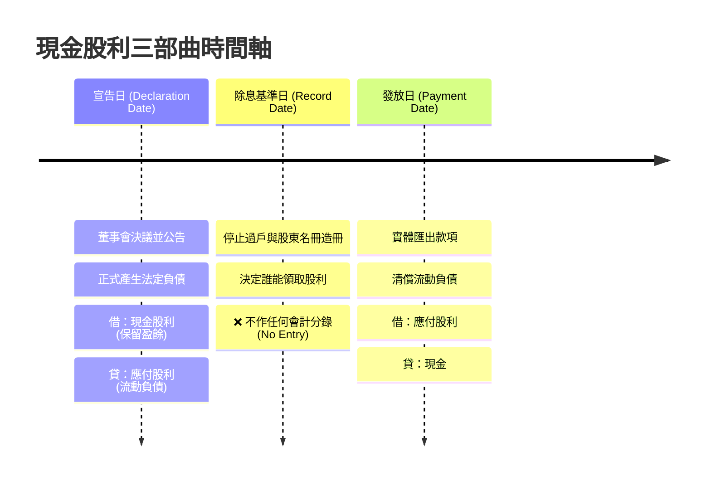
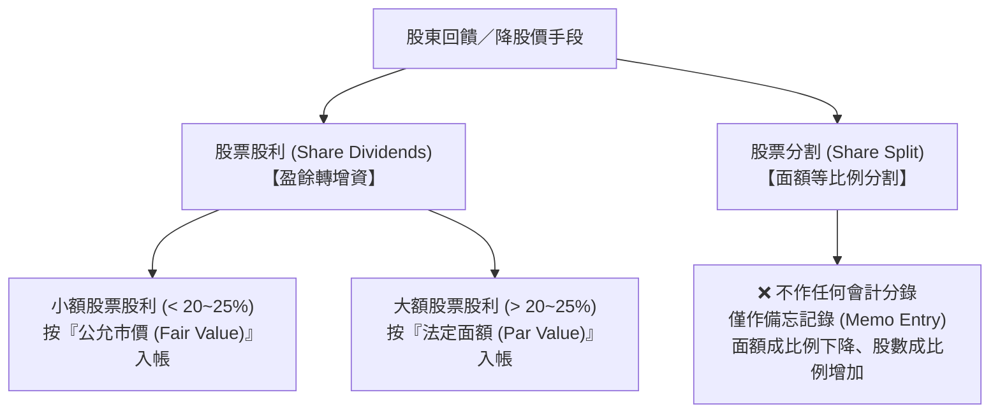

# [Ch 12 專題] 股利分配、股票分割與權益變動表 (Dividends & Statement of Changes in Equity)

> 本頁深入剖析現金股利之三重要日期、特別股積欠股利分配、股票股利（大小額區分）與股票分割之差異矩陣、Class Exercise 1 (Lucerne Company AG) 與 Class Exercise 2 (Chamblin AG 權益變動表) 的完整詳解。

---

## 1. 現金股利之發放條件與三個關鍵日期 (Cash Dividends)

企業發放現金股利必須**同時具備三大要件**：
1. **足額的保留盈餘 (Retained Earnings)**：法定可供分配之盈餘來源。
2. **充足的現金 (Adequate Cash)**：有足夠的流動資金實際支付。
3. **董事會決議宣告 (Board Declaration)**：由最高決策機構合法宣告。



---

## 2. 特別股股利分配與積欠股利 (Dividends in Arrears)

### 累積特別股分配順序鐵律：
當年度董事會宣告發放股利時，資金分配順序如下：
1. **第一優先**：補足過去年度未發放之**累積積欠股利 (Dividends in Arrears)**。
2. **第二優先**：支付特別股**本期應得股利**（特別股面額 $\times$ 約定股利率）。
3. **剩餘部分**：若有餘額，才由全體**普通股股東**均分。

---

## 3. 股票股利 vs. 股票分割 (Share Dividends vs. Share Splits)

企業希望在保留現金的前提下回饋股東或壓低股價，通常採用**股票股利**或**股票分割**：



### 兩者對股東權益之影響對比矩陣 (Illustration 12.18)

| 財務項目 | 股票股利 (Share Dividends) | 股票分割 (Share Split) | 現金股利 (Cash Dividends) |
| :--- | :---: | :---: | :---: |
| **保留盈餘 (Retained Earnings)** | **減少 (Decrease)** | **不變 (No Change)** | **減少 (Decrease)** |
| **股本總額 (Share Capital)** | **增加 (Increase)** | **不變 (No Change)** | **不變 (No Change)** |
| **每股面額 (Par Value per Share)** | **不變 (No Change)** | **減少 (Decrease)** | **不變 (No Change)** |
| **流通在外股數 (Shares Outstanding)** | **增加 (Increase)** | **增加 (Increase)** | **不變 (No Change)** |
| **股東權益總額 (Total Equity)** | **不變 (No Change)** | **不變 (No Change)** | **減少 (Decrease)** |

---

## 4. 經典課堂題解：Class Exercise 1 (Lucerne Company AG)

### 題目背景
Lucerne Company AG 於 10 月 31 日權益結構：普通股股本 $300,000（面額 $6，流通在外 50,000 股），保留盈餘 $860,000，股東權益合計 $1,160,000。目前股票市價為每股 $13。
公司正評估三種獨立行動方案：
1. **方案 (1)**：宣告發放 5% 股票股利（小額股票股利）。
2. **方案 (2)**：宣告並發放每股 $0.5 現金股利。
3. **方案 (3)**：執行 2:1 股票分割（面額降至 $3）。

---

### 各方案對權益項目之影響彙總表

| 項目 | 變動前 (Before) | (1) 發放 5% 股票股利 | (2) 發放現金股利 | (3) 執行 2:1 股票分割 |
| :--- | :---: | :---: | :---: | :---: |
| **普通股股本** | $300,000 | **$315,000** | $300,000 | $300,000 |
| **資本公積－股票溢價** | $0 | **$17,500** | $0 | $0 |
| **保留盈餘** | $860,000 | **$827,500** | **$835,000** | $860,000 |
| **股東權益總計** | **$1,160,000** | **$1,160,000** | **$1,135,000** | **$1,160,000** |
| **流通在外股數** | 50,000 股 | **52,500 股** | 50,000 股 | **100,000 股** |
| **每股面額** | $6 | $6 | $6 | **$3** |

#### 數值推導明細：
* **方案 (1) 5% 股票股利（增發 $50,000 \times 5\% = 2,500$ 股）**：
  * 因屬小額股票股利，按市價 $13 衡量：保留盈餘減少 $= 2,500 \times \$13 = \mathbf{\$32,500}$。
  * 股本面額增加 $= 2,500 \times \$6 = \mathbf{\$15,000}$。
  * 差額計入資本公積 $= 2,500 \times (\$13 - \$6) = \mathbf{\$17,500}$。
  * 總權益維持 $1,160,000 完全不變。
* **方案 (2) 每股 $0.5 現金股利**：
  * 現金股利總額 $= 50,000 \times \$0.5 = \mathbf{\$25,000}$。
  * 保留盈餘降至 $\$860,000 - \$25,000 = \mathbf{\$835,000}$，總權益減少 $25,000。
* **方案 (3) 2:1 股票分割**：
  * 股數加倍為 $100,000$ 股，每股面額減半為 $\$3$。無分錄，金額全數不變。

---

## 5. 權益變動表實戰題解：Class Exercise 2 (Chamblin AG, P12.9)

### 題目背景與交易事項 (2025 年度)
1. **1/1 期初餘額**：普通股股本 €800,000（面額 €2，已發行 400,000 股）、待分配普通股股票股利 €120,000（60,000 股）、資本公積－普通股 €500,000、保留盈餘 €600,000。總權益 €2,020,000。
2. **2/1**：正式發行 60,000 股股票（兌現前期宣告之 15% 股票股利）。
3. **4/14**：以每股 €4 現金發行 25,000 股普通股。
4. **9/3**：以每股 €5 買回 22,000 股自家股票作為庫藏股。
5. **11/10**：宣告並發放現金股利 €111,000。
6. **11/30**：以每股 €5 出售 8,000 股庫藏股（成本 €5）。
7. **12/31**：本年度賺得淨利 €360,000。

---

### (a) 2025 年度權益變動表 (Statement of Changes in Equity)

```text
Chamblin AG
權益變動表 (Statement of Changes in Equity)
截至 2025 年 12 月 31 日止年度
```

| 項目 (Transaction) | 普通股股本 (€2 面額) | 待分配股票股利 | 資本公積－股票溢價 | 保留盈餘 | 庫藏股 (成本法) | 股東權益合計 |
| :--- | :---: | :---: | :---: | :---: | :---: | :---: |
| **2025/1/1 期初餘額** | **€800,000** | **€120,000** | **€500,000** | **€600,000** | **€0** | **€2,020,000** |
| 2/1 發放待分配股票股利 | +120,000 | -120,000 | | | | 0 |
| 4/14 現金增資發行新股 | +50,000 | | +50,000 | | | +100,000 |
| 9/3 買回庫藏股 (22,000股) | | | | | -110,000 | -110,000 |
| 11/10 發放現金股利 | | | | -111,000 | | -111,000 |
| 11/30 出售庫藏股 (8,000股) | | | | | +40,000 | +40,000 |
| 12/31 本期淨利結轉 | | | | +360,000 | | +360,000 |
| **2025/12/31 期末餘額** | **€970,000** | **€0** | **€550,000** | **€849,000** | **(€70,000)** | **€2,299,000** |

---

### (b) 2025 年 12 月 31 日資產負債表（股東權益部分表達）

```text
Chamblin AG
資產負債表 (部分) - 2025 年 12 月 31 日
---------------------------------------------------------------------------------
股東權益 (Shareholders' Equity)：
  普通股股本 (面額 €2，已發行 485,000 股，流通在外 471,000 股)      €970,000
  資本公積－普通股溢價                                            €550,000
  保留盈餘                                                        €849,000
  減：庫藏股 (14,000 股，成本法)                                   (€70,000)
---------------------------------------------------------------------------------
股東權益總計                                                   €2,299,000
```
* **股數勾稽驗算**：
  * 已發行股數 $= 400,000 \text{ (初)} + 60,000 \text{ (2/1)} + 25,000 \text{ (4/14)} = \mathbf{485,000 \text{ 股}}$。
  * 庫藏股股數 $= 22,000 - 8,000 = \mathbf{14,000 \text{ 股}}$。
  * **流通在外股數 (Outstanding Shares)** $= 485,000 - 14,000 = \mathbf{471,000 \text{ 股}}$。

---

## 6. 企管管理者視角 (Management Implications)

1. **股利平穩政策與顧客效果 (Clientele Effect)**：
   * 資本市場極度厭惡「忽高忽低」的股利政策。成熟企業通常採取「穩定發放現金股利」策略，吸引偏好穩定現金流的退休基金與機構法人（顧客效果）。
2. **股票分割的「散戶流動性魔術」**：
   * 當股價漲到 $500 ~ $1,000 以上時，散戶買不起一張（流動性降低）。實施股票分割雖然公司實質價值沒變，但能有效拉低每股門檻，激勵散戶進場交易，活絡股票成交量。

---

## 7. 關聯主題 (Related Concepts)

* [[Ch12-Corporations-and-Equity]] — Chapter 12 核心導航
* [[ROE-and-Shareholder-Metrics]] — 股東權益報酬率與每股淨值指標
* [[Equity-Financing-and-Cash-Flow]] — 現金股利 vs. 股票股利對現金流量表之影響
