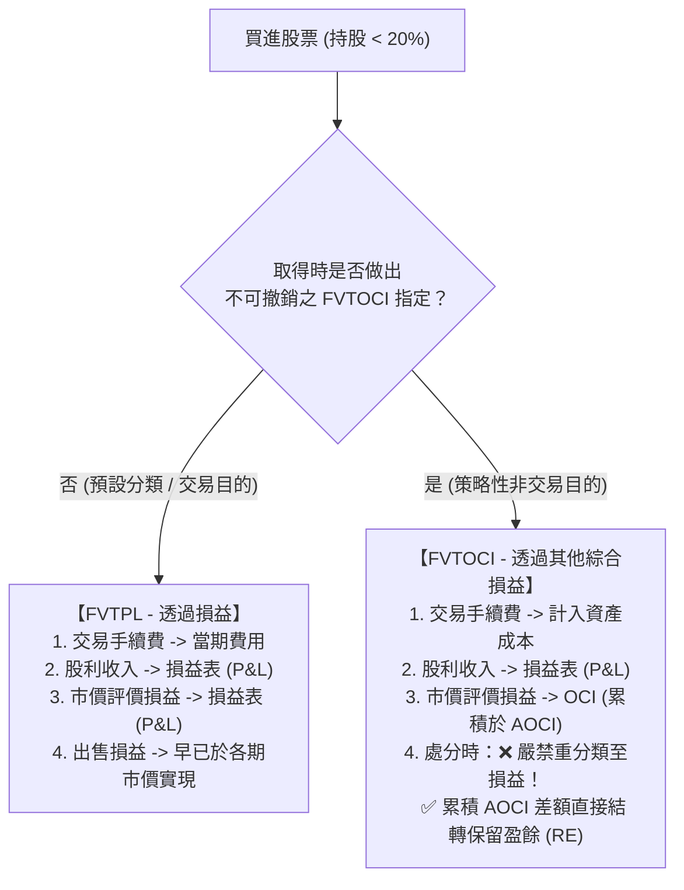

# [Ch 13 專題] 債券與股票投資之計量、評價與重分類循環 (Valuation, Accounting & Recycling)

> 本頁深入演繹債務工具（AC / FVTOCI / FVTPL）與權益工具（<20% FVTPL vs. FVTOCI）之完整會計循環、期末公允價值評價調整分錄，以及**「債券 FVTOCI 允許重分類 (Recycling) vs. 股票 FVTOCI 嚴禁重分類」**之核心準則差異。

---

## 1. 債務工具投資三模式會計處理 (Debt Investments)

### (1) 按攤銷後成本衡量 (Financial Assets at Amortized Cost)
* **適用條件**：經營模式為「收取合約現金流量（Hold to Collect）」，且現金流量完全符合本金及利息之支付 (SPPI)。
* **會計特性**：資產負債表日**不隨公開市價波動調整帳面價值**！
* **折溢價攤銷與到期結清**：
  * 若折價購入（票面利率 < 市場利率）：每期認列之「利息收入」大於「收取之票面利息」，差額借記投資帳戶（攤銷折價）。
  * 到期日帳面價值必然收斂等於**面額 (Face Value)**：
  ```text
  到期收回本金：
  借：現金 (Cash)                                      €100,000
      貸：按攤銷後成本衡量之金融資產 (Financial Assets at AC)     €100,000
  ```

---

### (2) 透過其他綜合損益按公允價值衡量之債券 (Debt Investments: FVTOCI)
* **適用條件**：經營模式為「收取合約現金流量及出售（Hold to Collect and Sell）」。
* **取得時**：交易手續費計入資產成本。
* **期末評價**：市價與帳面價值之差額計入**其他綜合損益 (OCI)**，累積於權益項下之 **AOCI**：
  ```text
  12/31 公允價值自 €100,000 漲至 €102,500：
  借：公允價值調整－FVTOCI (Fair Value Adjustment)        €2,500
      貸：未實現評價損益－FVTOCI (OCI)                             €2,500
  (期末結帳時將此 OCI 轉入權益項下之 AOCI)
  ```
* **處分與重分類調整 (Recycling to Profit or Loss)**：
  * **當債券出售時，先前累積在 AOCI 中的未實現損益，必須「重分類（Recycle）」至當期損益表之「營業外收入－處分金融資產利益」**！
  ```text
  出售時重分類分錄：
  借：未實現評價損益－FVTOCI (OCI)                       €2,500
      貸：處分金融資產利益－債券 (Gain on Sale of FVTOCI-Debt)      €2,500
  (將累積於權益之利益轉入損益表，實現為當期淨利)
  ```

---

### (3) 透過損益按公允價值衡量之債券 (Debt Investments: FVTPL - 交易目的)
* **適用條件**：短期內頻繁買賣以賺取價差（Trading）。列為**流動資產**。
* **交易成本**：手續費於**發生時直接列為當期費用**。
* **期末評價**：公允價值變動**直接認列於當期損益表 (P&L)**：
  ```text
  借：評價損失－FVTPL (Loss on Financial Assets at FVTPL)    €8,000
      貸：公允價值調整－FVTPL (Fair Value Adjustment)               €8,000
  (此損失直接扣減當期淨利)
  ```

---

## 2. 權益工具投資（持股 < 20%）：FVTPL vs. FVTOCI 深度辨析

當企業買進他公司股票且持股低於 20%（無重大影響力）時，IFRS 9 提供兩種路徑：



---

## 3. 重分類核心禁令：為什麼「股票 FVTOCI」絕對不能重分類 (No Recycling)？

這是初會二與高會中最重要、也最常考的 IFRS 觀念：

### 債券 FVTOCI vs. 股票 FVTOCI 處分清算對比表

| 比較項目 | 債券投資 (Debt FVTOCI) | 股票投資 (Equity FVTOCI) |
| :--- | :--- | :--- |
| **合約現金流特性** | 有明確到期日、固定面額與利息 | 無到期日、價格受市場情緒波動劇烈 |
| **累積於 AOCI 之評價損益** | 最終一定會隨到期收回本金而結清 | 可能長期劇烈上下起伏 |
| **出售時能否轉入損益表？** | ✅ **允許重分類（Recycling to P&L）**<br>轉列為損益表之「處分利益／損失」 | ❌ **嚴禁重分類（No Recycling to P&L）**<br>全數差額直接自 AOCI 轉入**「保留盈餘 (RE)」**！ |
| **防範之管理舞弊風險** | 無特定舞弊空間 | **防範經理人操縱盈餘 (Cherry-Picking)**：若允許股票重分類，經理人可在公司本業虧損時，故意賣出大賺的股票美化當期淨利；在股票大跌時故意不賣藏在 OCI。 |

### 股票 FVTOCI 處分之標準分錄示範 (Su Company 案例)
Su 公司出售成本 €20,000、AOCI 累積評價利益 €2,500 之 Taur 股票，售價 €22,500：
```text
(1) 記錄出售收現：
借：現金 (Cash)                                      €22,500
    貸：透過其他綜合損益按公允價值之金融資產 (FVOCI-Equity)      €20,000
    貸：公允價值調整－FVTOCI (Fair Value Adjustment)             €2,500

(2) 結轉權益項目（絕不經過損益表！）：
借：累積其他綜合損益 (AOCI)                           €2,500
    貸：保留盈餘 (Retained Earnings)                              €2,500
(將歷年累積於 AOCI 之已實現利得全數直接結轉保留盈餘)
```

---

## 4. 企管管理者視角 (Management Implications)

1. **財務長 (CFO) 的金融資產劃分智慧**：
   * **營運閒置資金**：劃入流動性極高的貨幣型基金或短期政府公債（AC 或 FVTPL），方便隨時變現調度。
   * **策略夥伴股權**：如企業為鞏固上游原料或技術授權而持有的同業股份（<20%），一律在購入首日指定為 **FVTOCI**。如此一來，即便資本市場崩跌，股價損失只會體現在資產負債表權益項下的 AOCI，**絕對不會玷污損益表上的營業利潤與 EPS**！

---

## 5. 關聯主題 (Related Concepts)

* [[Ch13-Investments]] — Chapter 13 核心導航
* [[Ch13-Equity-Method-and-Consolidations]] — 權益法與控制力合併報表
* [[Investment-Returns-and-Yields]] — 投資收益率與殖利率分析
* [[Investment-Classification-and-Earnings-Quality]] — 盈餘品質與淨利波動專題
