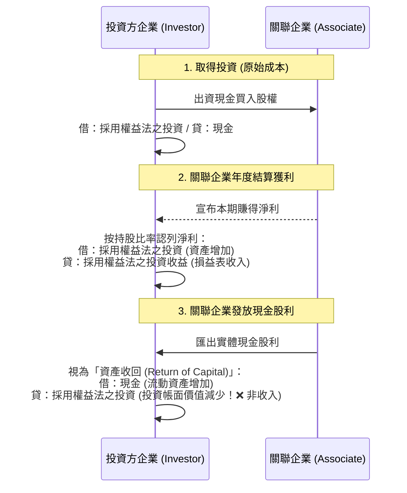

# [Ch 13 專題] 權益法、合併財務報表與經典實戰對照 (Equity Method & Consolidations)

> 本頁深入剖析持股 20%~50% 之「採用權益法之投資 (Equity Method)」、持股 >50% 之「合併財務報表」核心原理，以及 Class Exercise 1 (Control Alt Design Ltd. vs. Walter Co.) 之「公允價值法 vs. 權益法」雙軌全流程對照詳解。

---

## 1. 重大影響力與關聯企業 (Significant Influence & Associates)

當企業持有另一家公司 **20% 至 50% 之表決權股份** 時，會計準則推定其對被投資公司具備**重大影響力 (Significant Influence)**：
* **關聯企業 (Associate)**：被投資公司稱為投資方之關聯企業。
* **重大影響之實質要件**：
  * 在被投資公司之董事會擁有席位，得以參與營運及財務政策決策。
  * 彼此間存在重大跨公司交易、互派高階管理人員、或提供不可或缺之核心關鍵技術。
* **法定處理準則**：**強制採用「權益法 (Equity Method)」**核算。

---

## 2. 權益法之核心運作機制 (The Mechanics of Equity Method)

權益法將投資方與關聯企業視為「命運共同體」：



> [!IMPORTANT] 核心觀念陷阱：為什麼權益法下「收到股利不是收入」？
> * 當被投資公司賺錢時，投資方已經在第 2 步**全額按持股比率認列了「投資收益」並墊高了投資帳面價值**。
> * 當被投資公司發放現金股利時，只是將其體內的淨資產轉化為現金匯給投資方。若投資方此時再認列一次股利收入，就會造成**重複認列獲利**！因此收到股利必須**直接扣減投資帳面價值**。
> * **期末市價波動**：權益法著眼於被投資公司實質經營成果，**期末完全不作公允價值調整**（無視公開市場短線股價起伏）。

---

## 3. 控制力與合併財務報表 (Contingent Interest & Consolidations, > 50%)

* 當持股超過 50% 時，投資方對被投資公司具備**實質控制力 (Control)**：
  * 投資方稱為**母公司 (Parent Company)**。
  * 被投資公司稱為**子公司 (Subsidiary)**。
* **合併報表 (Consolidated Financial Statements, IFRS 10)**：
  * 在法律上，母子公司是各自獨立的法人；但在經濟實質上，母子公司構成**單一經濟實體 (Single Economic Entity)**。
  * 母公司在編製對外財報時，必須將母子公司的資產、負債、營收與費用**逐行百分之百合併加總**，並全數沖銷內部交易（如母子間互相賒銷、借貸）。

---

## 4. 經典課堂題解：Class Exercise 1 (Control Alt Design Ltd., P13.4 完整詳解)

### 題目背景
Control Alt Design Ltd. 於 2025 年 1 月 1 日以 **£800,000** 取得 Walter Company 30% 普通股股權（45,000 股）。
2025 年營運事項如下：
1. Walter 於 3/15、6/15、9/15、12/15 分別宣告並發放每股 £0.30 之現金股利（全年每股發放 £1.20，總計發放 £54,000）。
2. Walter 於 2025 年度賺得**淨利 £320,000**（30% 份額為 £96,000）。
3. 2025 年 12 月 31 日，Walter 公司每股市價為 **£24**（總公允價值 $= 45,000 \times £24 = \mathbf{£1,080,000}$）。

---

### (a) 與 (b) 雙軌會計分錄全景對照

| 日期與交易事項 | 方案 (a)：公允價值法 (FVPL / 交易目的 / 無重大影響) | 方案 (b)：權益法 (Equity Method / 具重大影響力) |
| :--- | :--- | :--- |
| **1 月 1 日**<br>以 £800,000 購入 45,000 股 | `借：金融資產－FVPL (股票)  £800,000`<br>`    貸：現金                   £800,000` | `借：採用權益法之投資      £800,000`<br>`    貸：現金                   £800,000` |
| **3/15、6/15、9/15、12/15**<br>每季收到股利 £13,500<br>($£0.3 \times 45,000$) | `借：現金                    £13,500`<br>`    貸：股利收入 (P&L)          £13,500`<br>*(全年 4 季累計認列股利收入 £54,000)* | `借：現金                    £13,500`<br>`    貸：採用權益法之投資        £13,500`<br>*(全年 4 季累計自投資帳面價值扣除 £54,000)* |
| **12 月 31 日**<br>Walter 賺得淨利 £320,000 | ❌ **不作任何分錄 (No Entry)** | `借：採用權益法之投資       £96,000`<br>`    貸：採用權益法之投資收益    £96,000`<br>*($£320,000 \times 30\% = £96,000$)* |
| **12 月 31 日**<br>市價漲至 £24 (總值 £1,080,000) | `借：公允價值調整－FVPL    £280,000`<br>`    貸：金融資產評價利益 (P&L)  £280,000`<br>*($£1,080,000 - £800,000 = £280,000$)* | ❌ **不作任何分錄 (No Entry)**<br>*(權益法不隨公開市場短線波動調整)* |

---

### (c) 2025 年 12 月 31 日財務報表表達比較 (Statement Presentation)

```text
一、資產負債表 (Statement of Financial Position)
【方案 (a) 公允價值法 FVPL】：
  流動資產 (Current Assets)：
    透過損益按公允價值衡量之金融資產－股票成本       £800,000
    加：公允價值調整－FVPL                          280,000
    期末公允價值總額                                           £1,080,000

【方案 (b) 權益法 Equity Method】：
  非流動資產－長期投資 (Investments)：
    採用權益法之投資 (期末帳面價值)                             £842,000
    *(計算推導：£800,000 成本 - £54,000 股利扣除 + £96,000 投資收益 = £842,000)*

---------------------------------------------------------------------------------
二、損益表 (Income Statement - 營業外收入項目)
【方案 (a) 公允價值法 FVPL】：
  股利收入 (Dividend Revenue)                                    £54,000
  金融資產評價利益－FVPL (Gain on Financial Assets)              280,000
  對當期淨利之總貢獻                                             £334,000

【方案 (b) 權益法 Equity Method】：
  採用權益法之投資收益 (Revenue from Equity Investments)          £96,000
  對當期淨利之總貢獻                                              £96,000
```

---

## 5. 企管決策與財務警訊 (Management Implications)

1. **報表呈現差距與經理人偏好**：
   * 在 Class Exercise 1 中，Walter 股票在資本市場大漲，使 FVPL 法認列了高達 £334,000 的龐大利潤；而權益法僅穩健認列實質經營獲利 £96,000。
   * 企管學生必須看懂：**公允價值法反映的是「金融市場對該公司的定價波動」；權益法反映的是「被投資公司本業的賺錢能力」**。
2. **權益法隱藏的「表外負債 (Off-Balance-Sheet Leverage)」**：
   * 權益法下，投資方只在資產負債表列示一行「採用權益法之投資」淨額。關聯企業本身的鉅額銀行借款或負債比率，**完全不會出現在投資方的資產負債表上**！
   * 經理人有時會刻意將持股壓在 49%（避免超過 50% 強制合併），藉此掩蓋高風險擴張項目的實質負債。

---

## 6. 關聯主題 (Related Concepts)

* [[Ch13-Investments]] — Chapter 13 核心導航
* [[Ch13-Debt-and-Equity-Valuation]] — 債券與股票投資公允價值評價
* [[Investment-Returns-and-Yields]] — 投資收益率與殖利率分析
* [[Investment-Classification-and-Earnings-Quality]] — 盈餘品質與淨利波動專題
