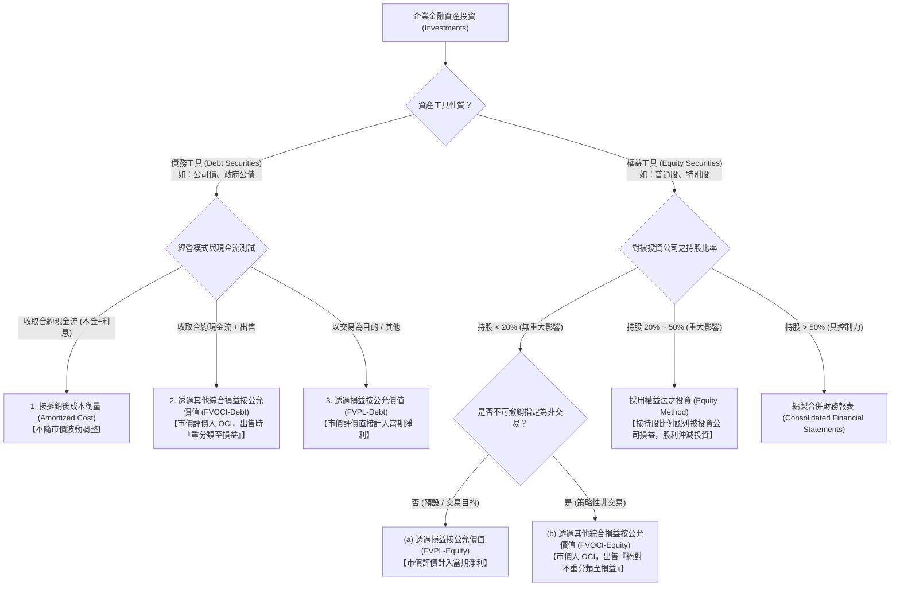

# [Ch 13] 金融資產投資與權益法 (Investments: Debt, Equity & Equity Method)

> 本頁面為 Chapter 13 的核心骨幹與全覽。涵蓋企業投資的三大動機、IFRS 9 金融資產分類決策模型、債務工具（AC / FVOCI / FVPL）與權益工具投資（<20% 公允價值法、20%~50% 權益法、>50% 合併報表）之架構地圖。
> 依據教材：Jerry J. Weygandt, *Financial Accounting (IFRS 5th Edition)*, Chapter 13.

---

## 1. 企業投資的三大核心動機 (Why Corporations Invest?)

企業在經營過程中購買債券或股票等金融資產，通常基於三大商業目的：
1. **去化多餘閒置資金 (Deploy Excess Cash)**：
   * 季候性營運產生的大量閒置現金（如零售業旺季過後），為防通膨侵蝕，暫時投入低風險、高流動性的貨幣市場工具或短期政府公債。
2. **獲取穩定投資收益 (Generate Investment Income)**：
   * 透過長期持有債券賺取固定利息（Interest Revenue），或持有優質藍籌股賺取穩定股利（Dividend Revenue）及資本利得。
3. **戰略布局與產業結盟 (Strategic Alliances & Control)**：
   * 取得關鍵供應商、經銷商或具潛力新創之股權（重大影響力），強化垂直整合；或收購同業過半股權取得經營控制權（合併財務報表）。

---

## 2. IFRS 9 金融資產分類架構地圖 (IFRS 9 Classification Map)

IFRS 9 將金融資產依**「合約現金流量特徵（SPPI 測試）」**與**「企業經營模式（Business Model）」**，以及**「對發行公司之影響力程度」**，劃分為清晰的決策矩陣：

---

## 3. 債務與權益投資全覽對比

| 投資類別 | 衡量基礎 | 交易成本處理 | 期末公允價值評價 | 處分已實現損益處理 |
| :--- | :--- | :--- | :--- | :--- |
| **債券：攤銷後成本 (AC)** | 攤銷後成本 (Cost) | 計入資產成本 | ❌ 不隨市價調整 | 比較售價與攤銷後成本，差額計入損益 |
| **債券：FVOCI** | 公允價值 (Fair Value) | 計入資產成本 | ✅ 計入 OCI (AOCI 權益) | ✅ **重分類調整（Recycling）至損益表** |
| **債券：FVPL (交易)** | 公允價值 (Fair Value) | 當期費用化 | ✅ 直接計入當期淨利 (P&L) | 售價即為最新公允價值，損益早已入帳 |
| **股票：FVPL (交易)** | 公允價值 (Fair Value) | 當期費用化 | ✅ 直接計入當期淨利 (P&L) | 售價即為最新公允價值，損益早已入帳 |
| **股票：FVOCI (非交易)** | 公允價值 (Fair Value) | 計入資產成本 | ✅ 計入 OCI (AOCI 權益) | ❌ **嚴禁重分類至損益，直接結轉保留盈餘** |
| **股票：權益法 (20%~50%)** | 權益帳面價值 | 計入資產成本 | ❌ 不隨公開市價波動調整 | 比較售價與權益帳面價值，差額計入損益 |

---

## 4. 全章專題頁面導航

1. [[Ch13-Debt-and-Equity-Valuation]]：
   * 債務工具三大模式（AC 折溢價攤銷、FVOCI 重分類循環、FVPL 快速交易）完整分錄與 T 字帳。
   * 權益工具（<20%）之 FVPL vs. FVOCI：深入剖析**「為什麼股票 FVOCI 出售時絕對不能重分類至損益表（No Recycling）」**。
2. [[Ch13-Equity-Method-and-Consolidations]]：
   * 採用權益法之投資（20%~50%）：**「被投資公司賺錢認列收益、發放股利視為資產收回」**之會計本質。
   * **Class Exercise 1 (Control Alt Design Ltd., P13.4) 完整題解**：公允價值法 vs. 權益法雙軌全流程對照表與四大報表勾稽。
3. [[Investment-Returns-and-Yields]]：
   * 財務比率庫：股利殖利率 (Dividend Yield)、投資收益率 (ROI) 與金融資產重分類禁令。
4. [[Investment-Classification-and-Earnings-Quality]]：
   * 跨章節綜合分析：金融資產會計分類對企業盈餘波動度之策略性影響（FVPL 淨利劇震 vs. FVOCI 損益避風港）。

---

## 5. 企管與管理者視角 (Management Implications)

1. **會計分類決定利潤表劇震程度 (Earnings Volatility Management)**：
   * 企業若將大量股票投資劃入 **FVPL**，每季股市的大漲大跌都會直接灌入當期淨利，導致 EPS 劇烈波動，干擾市場對本業獲利能力的評價。
   * 經理人若進行的是長期策略結盟（如台積電投資 ASML、鴻海投資群創），通常會在取得時**做出不可撤銷之指定，劃入 FVOCI**，將股價波動阻絕於損益表之外（僅入 OCI），保護營業利潤穩定。
2. **權益法下的「實質影響力」高於「20% 形式門檻」**：
   * 雖然 20% 是常規分水嶺，但在實務上，若持股僅 15% 但在董事會佔有席次、能參與重大經營政策決策，依實質重於形式原則，**依然必須強制採用權益法**！

---

## 6. 關聯主題 (Related Pages)

* [[Ch13-Debt-and-Equity-Valuation]] — 債券與股票投資公允價值評價深入演繹
* [[Ch13-Equity-Method-and-Consolidations]] — 權益法與合併報表機制（含 Class Exercise 1）
* [[Investment-Returns-and-Yields]] — 投資收益率與殖利率分析
* [[Investment-Classification-and-Earnings-Quality]] — 盈餘品質與淨利波動專題
* [[Ch14-Statement-of-Cash-Flows]] — 金融資產投資與現金流量表（營業 vs 投資活動）勾稽
