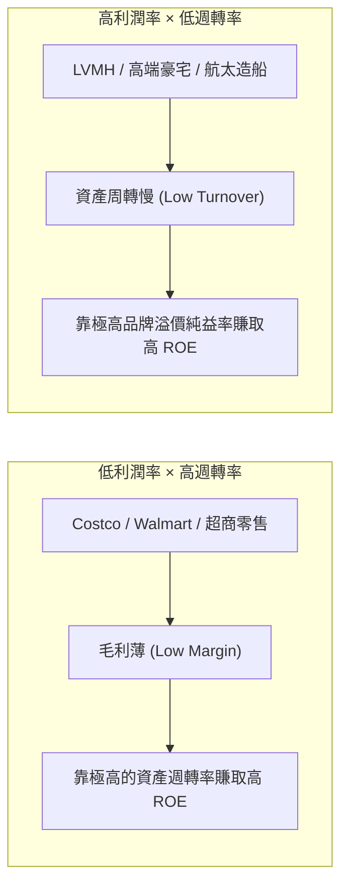

# [財務比率] 資產週轉率與營運效率分析 (Asset Turnover Ratio)

> 本頁定義資產週轉率 (Asset Turnover Ratio)，解析其在杜邦分析（DuPont Analysis）中的地位，並對比「重資產 vs. 輕資產」之商業模式策略。

---

## 1. 核心公式與計算定義 (Formula & Definition)

資產週轉率衡量企業**運用整體資產創造營業收入的效率**。比率愈高，代表每一元的資產投入能轉換出愈多的營業額，資產使用效能愈高。

$$\text{Asset Turnover Ratio (次數)} = \frac{\text{Net Sales (銷貨淨額)}}{\text{Average Total Assets (平均資產總額)}}$$

* **平均資產總額 (Average Total Assets)**：
  $$\text{Average Total Assets} = \frac{\text{期初資產總額} + \text{期末資產總額}}{2}$$

---

## 2. 杜邦分析系統中的戰略定位 (DuPont Analysis Framework)

在企管財務分析中，資產週轉率是驅動**股東權益報酬率 (ROE)** 的三大引擎之一：

$$\text{ROE} = \underbrace{\frac{\text{Net Income}}{\text{Net Sales}}}_{\text{純益率 (獲利能力)}} \times \underbrace{\frac{\text{Net Sales}}{\text{Average Assets}}}_{\mathbf{\text{資產週轉率 (營運效率)}}} \times \underbrace{\frac{\text{Average Assets}}{\text{Average Equity}}}_{\text{權益乘數 (財務槓桿)}}$$

### 商業模式對比：薄利多銷 vs. 高毛利專賣

---

## 3. 企管決策：重資產 vs. 輕資產策略 (Heavy vs. Light Assets)

1. **重資產模式 (Capital-Intensive / Asset-Heavy)**：
   * 如半導體晶圓代工（台積電）、航運公司、石化鋼鐵廠。
   * 特性：固定資產比例極高、每年折舊費用龐大、**資產週轉率通常較低**。
   * 風險：產能利用率一旦下降，高額固定折舊成本將迅速侵蝕利潤（高營業槓桿 Operating Leverage）。
2. **輕資產模式 (Asset-Light Strategy)**：
   * 如 IC 設計公司（聯發科、NVIDIA）、軟體公司、外包代工品牌（Nike）。
   * 特性：廠房設備多採租賃或外包代工，自身專注於研發與品牌，**資產週轉率極高**，資本負擔輕、變現靈活。

---

## 4. 關聯主題 (Related Concepts)

* [[Ch09-Plant-Assets]] — Chapter 9 固定資產架構
* [[AR-Turnover-and-DSO]] — 應收帳款週轉率與 DSO
* [[CapEx-Depreciation-and-Cash-Flow]] — 資本支出、折舊與現金流量表勾稽
