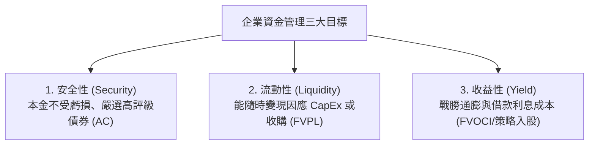

# [財務比率] 投資報酬率、殖利率與企業資金效益 (Investment Yields & ROI)

> 本頁定義衡量金融資產投資績效的核心指標：現金殖利率 (Dividend Yield)、投資報酬率 (Return on Investment, ROI) 與持有期間報酬率 (HPR)，並剖析企業司庫 (Corporate Treasury) 資金管理配置。

---

## 1. 核心公式與計算定義 (Formulas & Definitions)

### (1) 現金殖利率 (Dividend Yield)
衡量投資人或企業持有股票所獲得的現金股利相對於當前市場購入成本的比率：
$$\text{Dividend Yield (現金殖利率)} = \frac{\text{Annual Cash Dividend per Share (每股年度現金股利)}}{\text{Current Market Price per Share (當前每股市價)}}$$
* **企管判讀**：高現金殖利率（如 5% ~ 7%）通常意味著企業處於成熟期、股價防禦性高；但若殖利率過高，有時是因市場預期未來獲利衰退導致股價重挫所形成的「殖利率陷阱 (Yield Trap)」。

---

### (2) 投資報酬率 (Return on Investment, ROI)
衡量企業各項金融資產投資組合在特定期間創造之總收益（包含流動性收益與資本利得）：
$$\text{ROI (投資報酬率)} = \frac{\text{Total Investment Gain/Loss (當期股利/利息 + 未實現與已實現資本損益)}}{\text{Initial Cost of Investment (原始投資總成本)}}$$

---

## 2. 企管決策：企業司庫 (Corporate Treasury) 之閒置資金配置

大型企業（如微軟、蘋果、台積電）帳上常擁有數百億甚至上千億的現金與金融資產。企業司庫在管理這些資產時，遵循**三原則平衡模型**：

* **資金成本 (Cost of Capital / WACC) 檢驗**：
  * 若企業發行公司債的借款利率為 4%，而將閒置資金投入國庫券的收益率僅 2%，企業實質上處於**「負利差 (Negative Carry)」**的失血狀態。經理人應評估是否提早還債或啟動庫藏股買回。

---

## 3. 關聯主題 (Related Concepts)

* [[Ch13-Investments]] — Chapter 13 核心導航
* [[Ch13-Debt-and-Equity-Valuation]] — 金融資產評價與會計處理
* [[Ch13-Equity-Method-and-Consolidations]] — 權益法與合併報表
* [[Investment-Classification-and-Earnings-Quality]] — 盈餘品質與淨利波動專題
