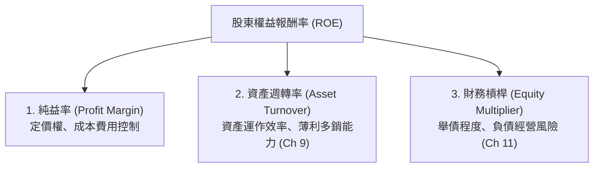

# [財務比率] 普通股東權益報酬率 (ROE) 與股東價值指標 (ROE & Shareholder Metrics)

> 本頁深入剖析普通股東權益報酬率 (Return on Ordinary Shareholders' Equity, ROE)、每股淨值 (Book Value per Share) 與股利發放率 (Payout Ratio)，並連結杜邦分析三階段拆解。

---

## 1. 普通股東權益報酬率 (ROE) 核心公式

ROE 是所有股東與資本市場最看重之核心獲利指標，衡量公司運用普通股股東所投入資本創造純利的能力：

$$\text{ROE (普通股東權益報酬率)} = \frac{\text{Net Income (本期淨利)} - \text{Preference Dividends (特別股股利)}}{\text{Average Ordinary Shareholders' Equity (平均普通股東權益)}}$$

### 關鍵扣除項說明：
* **特別股股利**：特別股享有股利優先權，其利潤本質類似「資金成本」，必須自淨利中扣除，剩餘之淨利方屬於普通股股東享有。
* **平均普通股東權益**：
  $$\text{Average Ordinary Equity} = \frac{\text{期初普通股東權益} + \text{期末普通股東權益}}{2}$$
  *(若有特別股股本，計算時應將特別股股本自權益總額中扣除)*

---

## 2. 杜邦分析終極三分解 (DuPont Analysis 3-Step Model)

ROE 的高低並非單一因素所決定，企管系分析時透過杜邦公式將其拆解為三大面向：

$$\text{ROE} = \underbrace{\left(\frac{\text{Net Income}}{\text{Sales}}\right)}_{\text{純益率 (獲利能力)}} \times \underbrace{\left(\frac{\text{Sales}}{\text{Average Assets}}\right)}_{\mathbf{\text{資產週轉率 (營運效率)}}} \times \underbrace{\left(\frac{\text{Average Assets}}{\text{Average Equity}}\right)}_{\mathbf{\text{權益乘數 (財務槓桿)}}}$$

> [!WARNING] 企管警訊：警惕「假性高 ROE」！
> 若一家企業的 ROE 很高，但純益率與資產週轉率卻在下滑，其高 ROE 可能是因為**過度舉債（權益乘數極高）**所硬撐出來的。一旦景氣反轉或利率上升，龐大的負債利息將引發財務危機。

---

## 3. 其他關鍵股東價值指標 (Other Shareholder Metrics)

### (1) 每股淨值 (Book Value per Share, BVPS)
衡量每股普通股在資產負債表上所代表之實質帳面價值（清算基準）：
$$\text{Book Value per Share} = \frac{\text{Ordinary Shareholders' Equity (普通股東權益總額)}}{\text{Number of Ordinary Shares Outstanding (期末流通在外普通股股數)}}$$

### (2) 股利發放率 (Payout Ratio)
衡量企業將當期賺得的獲利中，有多少比例以現金股利發還給股東：
$$\text{Payout Ratio} = \frac{\text{Cash Dividends Declared (宣告之現金股利總額)}}{\text{Net Income (本期淨利)}}$$
* **高發放率（60% ~ 80%）**：多為成熟期、缺乏高報酬再投資機會之現金牛企業（如電信、公用事業）。
* **低發放率（0% ~ 20%）**：多為高成長期、需要保留大量資金擴廠研發之企業（如高科技半導體業）。

---

## 4. 關聯主題 (Related Concepts)

* [[Ch12-Corporations-and-Equity]] — Chapter 12 核心導航
* [[Ch12-Dividends-and-Retained-Earnings]] — 股利政策與權益變動表
* [[Asset-Turnover]] — 資產週轉率指標
* [[Equity-Financing-and-Cash-Flow]] — 股本交易與現金流量表勾稽
