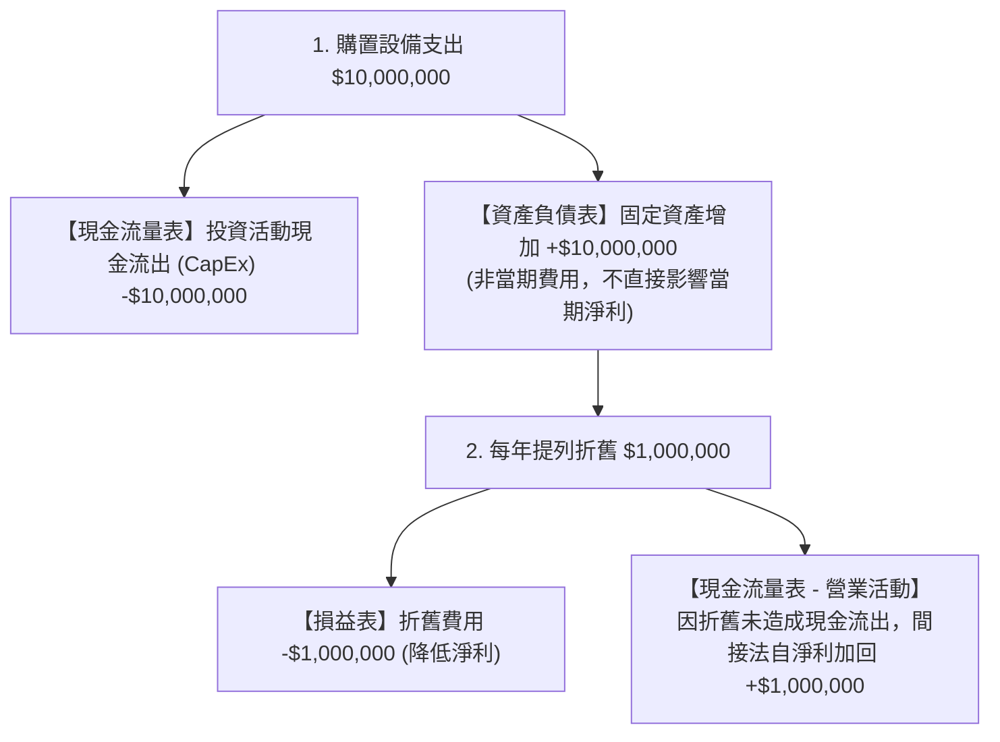

# [跨章節專題] 資本支出 (CapEx)、折舊與自由現金流之勾稽機制 (CapEx, Depreciation & Cash Flows)

> 本專題串聯 Chapter 9 (固定資產與折舊) 與 Chapter 14 (現金流量表)，剖析資本支出（CapEx）與折舊費用如何跨報表穿梭於損益表、資產負債表與現金流量表。

---

## 1. 核心穿透：從買進設備到報表收斂之生命週期

當企業花費 $1,000 萬購買一條全新半導體生產線（耐用 10 年），這筆交易如何在四大報表中穿梭？



---

## 2. 現金流量表（Chapter 14）中的勾稽調節項目

在現金流量表中，涉及 Chapter 9 固定資產與無形資產的項目如下：

```text
一、營業活動之現金流量 (Operating Activities - 間接法)
    本期淨利 (Net Income)
    調整非現金與投資損益項目：
      (+) 折舊費用 (Depreciation Expense)          --> 非現金支出，加回
      (+) 攤銷費用 (Amortization Expense)          --> 非現金支出，加回
      (+) 處分資產損失 (Loss on Disposal of PPE)     --> 屬投資活動，自淨利加回
      (-) 處分資產利益 (Gain on Disposal of PPE)     --> 屬投資活動，自淨利扣除

二、投資活動之現金流量 (Investing Activities)
    (-) 購置不動產、廠房及設備 (Capital Expenditures / CapEx) --> 現金實質流出
    (+) 處分不動產、廠房及設備收回價款 (Proceeds from Sale of PPE) --> 現金實質流入
```

### 關鍵迷思辨析：為什麼處分資產利益在營業活動是「減項」？
* 當企業出售舊設備賺得處分利益 €41,000（如 Jimenez 案例），這 €41,000 已經計入本期淨利中。
* 但賣設備收到的**全部現金（€466,000，含成本與利益）**必須全數歸類在「投資活動現金流量」。
* 為避免營業活動與投資活動**重複計算現金流入**，在營業活動的間接法中，必須將淨利中所包含的「處分利益」扣除。

---

## 3. 企管核心財務指標：自由現金流 (Free Cash Flow, FCF)

企管系學生評估一家企業是否真正具備自我造血能力時，最重要的指標就是**自由現金流 (FCF)**：

$$\text{Free Cash Flow} = \text{Operating Cash Flow (營業活動淨現金流入)} - \text{Capital Expenditures (資本支出 CapEx)}$$

### 商業訊號解讀：
* **FCF > 0（健康的現金牛企業）**：代表本業賺得的現金，扣除維持與擴充廠房設備所需的資本支出後，**仍有充裕的自由現金**可用於發放股利、償還公司債或研發創新。
* **FCF < 0（持續失血或高成長重資本企業）**：若企業連年 FCF 為負，即便損益表有淨利，也必須依賴向銀行借款（Chapter 11）或增資印股票（Chapter 12）才能維繫營運，面臨高融資風險。

---

## 4. 關聯頁面 (Related Concepts)

* [[Ch09-Plant-Assets]] — Chapter 9 固定資產架構
* [[Ch09-Depreciation-and-Disposal]] — 折舊方法與資產處分
* [[Ch09-Natural-Resources-and-Intangibles]] — 天然資源折耗與無形資產攤銷
* [[Ch14-Statement-of-Cash-Flows]] — 現金流量表編製與分析
