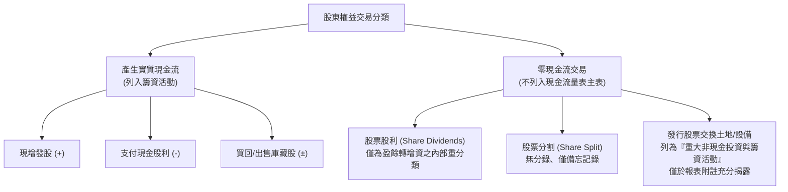

# [跨章節專題] 權益交易與現金流量表籌資活動之勾稽機制 (Equity & Financing Cash Flows)

> 本專題串聯 Chapter 12 (股本交易與權益) 與 Chapter 14 (現金流量表)，剖析籌資活動中實質現金流與「無現金流之內部重分類」的辨析標準。

---

## 1. 現金流量表（Chapter 14）中之籌資活動項目 (Financing Activities)

在現金流量表中，涉及 Chapter 12 股東權益的交易項目如下：

```text
三、籌資活動之現金流量 (Cash Flows from Financing Activities)
    (+) 現金增資發行新股收現 (Issuance of Ordinary/Preference Shares for Cash)
    (+) 出售庫藏股收回現金 (Sale of Treasury Shares for Cash)
    (-) 買回自家股票之現金流出 (Purchase of Treasury Shares)
    (-) 實際支付之現金股利 (Payment of Cash Dividends)
```

---

## 2. 關鍵辨析：哪些權益交易「完全不影響現金流量表」？

初會二學生最常犯的錯誤，是將所有股東權益交易都誤以為會產生現金流：



---

## 3. 現金股利之跨期跨表勾稽陷阱

現金股利在損益表、資產負債表與現金流量表之間的勾稽順序：

```text
宣告日 (Declaration)     --> 【資產負債表】流動負債 (應付股利) 增加，保留盈餘減少
                             (❌ 此時現金未流出，不影響現金流量表)

發放日 (Payment)         --> 【現金流量表 - 籌資活動】現金流出 = 應付股利沖減數
                             【資產負債表】流動負債 (應付股利) 減少，現金減少
```

> [!TIP] 勾稽公式：本期實際支付現金股利推導
> 若期初或期末有未支付之「應付股利 (Dividends Payable)」，本期籌資活動之現金股利流出金額為：
> $$\text{Payment of Cash Dividends} = \text{期初應付股利} + \text{本期宣告之現金股利} - \text{期末應付股利}$$

---

## 4. 關聯頁面 (Related Concepts)

* [[Ch12-Corporations-and-Equity]] — Chapter 12 核心導航
* [[Ch12-Dividends-and-Retained-Earnings]] — 股利政策與權益變動表
* [[ROE-and-Shareholder-Metrics]] — 股東價值指標與 ROE
* [[Ch14-Statement-of-Cash-Flows]] — 現金流量表籌資活動專題
